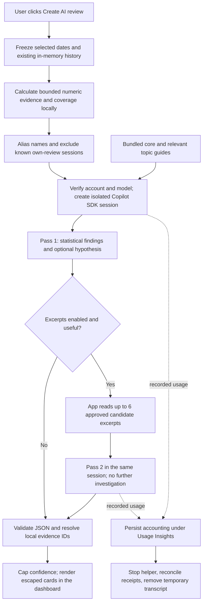

# Copilot Usage Insights

A local usage dashboard for the **GitHub Copilot desktop app**. Open it as a canvas to explore token usage, recorded AI credits, skill uses, models, projects, sessions, MCP servers, and installed plugins.

Forked from [Orca Usage Insights](https://github.com/Etherll/orca-usage-insights) by [Etherll](https://github.com/Etherll), and adapted for GitHub Copilot. The original MIT license and copyright notice are preserved in [LICENSE](LICENSE).

## Security and performance maintenance

[Security and update guidance](SECURITY.md) explains exactly what is installed, which data is read or sent, how to pause the plugin in Settings, and when to disable it in Copilot. The [2026-11-17 security/performance review](docs/security-performance-review-2026-11-17.md) includes architecture diagrams, synthetic scale measurements, fixes, remaining limits, and maintenance instructions. `npm run validate:security` checks the reviewed vendored artifact and CI pins offline; it is not a live vulnerability scanner. Host SDK/Node updates still come through Copilot.

[Audit follow-up issues](docs/audit-followups.md) record the storage, loading, validation and navigation decisions that require maintainer review, with measurements and acceptance criteria for future agents.

## Install in GitHub Copilot desktop

Use the GitHub Copilot desktop app with canvas support, signed in to your GitHub account. The app installs the plugin from this repository; you do not need to clone it or run npm commands.

### 1. Add the marketplace

1. Open **Customize** in the Copilot app sidebar.
2. Select the **marketplace settings control** next to the marketplace dropdown.
3. Follow the prompts to add a GitHub repository or Git URL. Paste this repository URL:

   ```text
   https://github.com/AndrewGodlewsky/copilot-usage-insights
   ```

4. Complete the add-marketplace prompts. If asked for a branch, use **`main`**.

The marketplace name is **`copilot-usage-insights`**. This repository hosts its catalog at [.github/plugin/marketplace.json](.github/plugin/marketplace.json); the URL to enter in the app is the repository URL above.

### 2. Install and enable the plugin

1. Open **Customize → Installed** and click **Add plugin**.
2. In the **Install plugin** dialog, paste this exact value into **Name**:

   ```text
   copilot-usage-insights@copilot-usage-insights
   ```

3. Click **Install**.
4. Make sure the plugin's toggle under **Customize → Installed** is **on**.

The Name field uses `plugin@marketplace`: the first part identifies the plugin and the second identifies the marketplace you added in step 1. You can also install it from **Customize → Browse** by selecting the **copilot-usage-insights** marketplace and searching for the plugin.

Adding the marketplace makes the plugin available to browse. Installing and enabling the plugin makes its canvas available to sessions. The marketplace and plugin both use the name `copilot-usage-insights`.

### 3. Open the dashboard

Start a **new session** in Copilot desktop and send:

> Open Usage Insights.

Copilot can call the plugin's `open_usage_insights` tool to open the dashboard in the right side panel. It reads local Copilot usage automatically. **Refresh** and **Settings** sit together at the right of the top toolbar and wrap together when space is limited. Use **Refresh** to reread the records or **Settings** to add other Copilot home folders.

The canvas tab is labeled **Usage Insights**. Copilot controls the tab width, icon spacing, and overflow fade; its plugin API does not expose settings for these. The title may fade near the close button when the host leaves too little room.

### Update an existing installation

In **Customize → Installed**, use **Update** in the Plugins section. Version **0.1.111** adds a persistent pause control, strengthens local data handling and improves large-history processing and dashboard updates. Refresh detects replaced journals more reliably, and Show logs explains the cost of verifying growing files. Close and reopen Usage Insights after updating. If Copilot has not picked up the updated extension, fully quit and restart it. See [dashboard recovery](docs/dashboard-recovery.md) for the diagnosis, behavior, and limits.

### WSL histories on Windows

**Include WSL usage sources (Windows)** is on by default in Settings. Running distributions are checked for standard `.copilot` homes and VS Code Server User storage. Receipts are combined with Windows usage using duplicate detection. Start any stopped distributions and click **Refresh**; **Local data sources** lists discovered homes and explains skipped or unreadable sources. Filters reuse the loaded history.

**Read locked usage databases inside WSL** is also on by default. If Windows gets a SQLite lock error, the plugin checks that the distribution is running, then uses its existing `/usr/bin/python3` and `sqlite3` module to read usage and session metadata in a read-only transaction. It installs nothing and makes no database copies. Missing Python, permissions, timeouts, or unsupported schemas leave a source warning while readable journals still count. Turn this setting off to disable the native fallback. Database rows remain a fallback only for sessions without journal receipts; this does not guarantee reconciliation with account billing.

For custom homes, use **Additional Copilot homes**, for example `\\wsl.localhost\Ubuntu\home\alice\.copilot`. Automatic discovery skips Docker Desktop and does not deliberately start stopped distributions. History from stopped distributions is not retained after a scan; custom paths remain explicit reads even if the automatic checkbox is off. See [WSL source coverage](docs/wsl-sources.md) for limitations, diagnostics, and verification steps.

### VS Code and environment filtering

**Include VS Code Copilot Chat** is on by default. The importer checks standard VS Code and Insiders User storage on Windows, macOS and Linux, plus accessible WSL VS Code Server storage. It includes calls with recorded Copilot charges, including zero-credit calls, and uses recorded input/output totals. Ordinary saved chats alone do not provide reliable billing history. Logging may need enabling in VS Code; older or deleted records cannot be recovered. [VS Code setup and coverage](docs/vscode-sources.md) explains the setting and custom User folders.

The menu immediately after **AI credits** starts at **All environments**. Select **Windows** or a discovered **WSL · distribution** to filter historical usage throughout the dashboard, including request expansions and activity. Changing environments clears model/project/session selections; date and cache preferences remain. Refresh preserves the selected environment, and **Reset filters** returns to All. Remote workspace metadata can identify WSL even when its logs are stored on Windows. A locally copied history without environment metadata is assigned to its storage host; it is not evidence of its original computer.

Source availability and skipped-record diagnostics describe all enabled sources. Installed plugins, live MCP connection status and explicit context inspection still describe the session hosting the dashboard; the environment filter does not remotely inspect another installation.

### If it does not appear

- **Marketplace added, plugin missing:** check that the URL is the repository URL above and that the marketplace is included in the Browse filter. Adding the marketplace does not install the plugin automatically.
- **Plugin installed, canvas unavailable:** check the toggle under **Customize → Installed**, then start a new session. Restart Copilot if it has not picked up the installation.
- **Dashboard opens but is empty:** make a request in Copilot, then click **Refresh**. Expand **Local data sources** to check which folders were read. Only available local usage records are counted.
- **Previously used the personal installer:** move its `usage-insights` folder out of `~/.copilot/extensions` before enabling the marketplace copy. On Windows, the default folder is `%USERPROFILE%\.copilot\extensions\usage-insights`. Keep one installed copy so the same tool is not registered twice. If you set `COPILOT_HOME`, use that folder instead of `~/.copilot`.

These steps follow GitHub's [plugin and marketplace setup instructions](https://docs.github.com/en/copilot/how-tos/github-copilot-app/customize-github-copilot-app#adding-a-plugin-marketplace). Desktop installation and rendering still need an in-app smoke test; automated checks cover the package entry and dashboard backend.

## Local development (optional)

Use this path to test changes from a local checkout. It requires Node.js 24 or later in addition to the Copilot desktop app. There are no npm dependencies to install; the YAML parser is bundled with its license under `src/vendor/js-yaml`.

From this repository:

```sh
npm test
npm run install:local
```

Then start a **new session** in the Copilot desktop app and ask:

> Open Usage Insights.

The extension exposes `open_usage_insights`, which opens the dashboard in the right side panel. If a session predates installation, start a new one; if the app has not discovered the extension yet, restart the app. You can also look under **Customize → Installed** for the canvas.

The installer copies the extension into `~/.copilot/extensions/usage-insights` (or `$COPILOT_HOME/extensions/usage-insights`). Rerun `npm run install:local` after making changes, then use a new session. It replaces only a previous installation carrying this installer's marker. Settings are stored separately and survive upgrades.

To remove the local installation, close its sessions and delete that `usage-insights` directory. Do not install both the personal extension and its marketplace package at the same time.

## Browser preview

```sh
npm run preview:demo  # synthetic data
npm run preview       # your local Copilot usage
```

Open the printed localhost URL in your browser. Stop with Ctrl+C. A browser preview exercises the dashboard; the desktop app supplies the SDK for the actual canvas integration.

## What is counted

The **Usage** view includes a token overview with total tokens, input including cache, output, uncached input, cache reads, cache writes, and cache hit rate. The daily chart and **Tokens by type** bar show how the total is divided. Hover over a count to see its full value. Chart popups keep their content width as the pointer moves, flip to the left when the right edge has insufficient room, and flip above near the bottom. Only the viewport itself limits their width on narrow canvases; long text still wraps within that limit. The **AI credits** selector changes the daily chart; the token summary remains visible. The token total card shows **Tokens** above the value and the selected date range underneath, including custom dates, and respects the model, project, session, and cache filters.

**Tokens by type** and its legend read **Uncached input → Cache read → Cache write → Output**. Input with an unknown cache split appears before Output when present; reasoning remains part of Output and is not counted again. Percentage labels alternate above and below the bar, with brackets pointing to their segments and extra spacing for clustered small shares. Shares use recorded token counts for the current filters or selected daily bar, not the minimum visual width used to keep tiny segments visible. Positive shares below 0.1% show **<0.1%**; rounded percentages can differ slightly from 100% in total. Missing tokens cannot contribute to these percentages. Turning off **Include cache tokens** leaves only uncached input and output in the bar.

This is an input-to-output reading order, not a strict timeline. Cache reads reuse input processing from a matching prefix; cache writes save a newly processed prefix for later reuse. The model generates output after processing its input. Reads and writes are input accounting categories, not additional copies of the same input tokens. See [Anthropic's prompt caching explanation](https://platform.claude.com/docs/en/build-with-claude/prompt-caching).

The **AI credits / prompt** summary card divides the sum of complete recorded charges for eligible user prompts by the number of distinct eligible prompts. A prompt's cost includes its initial model call, agent continuations, and subagent work with reliable parent links. Tool calls and continuations do not add prompts to the denominator. Charges come only from Copilot's `totalNanoAiu / 1e9`; no token-price estimate is used. Complete zero-credit prompts count. The caption shows the eligible count, such as **16 prompts**. **Review coverage**, available in the footer, explains exclusions and unlinked calls for the current filters. Hover over the card value for the same accounting context. With no eligible prompts, the card shows **Unavailable**.

Prompt attribution reuses identifiers collected during the existing `events.jsonl` scan: usage `apiCallId` links to assistant messages, then `interactionId` and, when present, `originatingMessageId` link to the initiating user message. IDs are scoped by session; replayed events and copied journals are deduplicated. No prompt text, tool arguments, or tool-result bodies are stored for this calculation. Explicit automated sources, autopilot continuations, inter-agent provenance, and agent-scoped messages do not count as human submissions. Older messages without an explicit source require a user-initiated first root call as corroboration. This is evidence from local records, not independent proof of human identity.

All linked work is grouped **before** filtering. Date, project, and session filters select the originating submission; its observed continuations count even if they finish after the selected date boundary. With a model filter, the card is explicitly labeled **selected-model contribution**: selected-model charges divided by eligible prompts that used those models. Eligibility still requires complete accounting across every linked model, including hidden ones. The cache-token setting does not affect prompt credits. Existing per-request metrics in the breakdown and Efficiency tab retain their per-model-call meaning.

Prompts with partial/missing charges, ambiguous attribution, or unfinished recorded turns, tools, or subagents are excluded as a whole. Subagents need matching parent-tool/agent links, child-call accounting, and completion evidence; names or timing alone are not enough. Unowned ordinary calls or ambiguous work conservatively exclude prompt candidates in the same journal session. Database-only history, older event formats, and separate child journals without reliable parent links may therefore provide little or no prompt coverage. Local logs cannot establish work that was never recorded, and the average can change as newly recorded work arrives. The implementation uses the [Copilot SDK event relationships](https://github.com/github/copilot-sdk/blob/main/nodejs/src/generated/session-events.ts), without a second scan or network request.

Recorded conversation-compaction charges are included in total usage. Without reliable prompt links they remain outside per-prompt averages and appear in unlinked-call coverage; they do not invalidate otherwise complete ordinary prompt costs. Compaction metadata never disables older sessions' database fallback, and journal compactions are omitted when fallback rows already account for that session. [Accounting details](docs/credit-undercount.md).

Explicit user cancellations and interrupted turns at a recorded session-resume boundary remain outside the average unless all linked work completes. They are informational when the interruption explains the exclusion and there is no contradictory attribution, missing call charge, or unfinished child work. An absent charge does **not** establish zero spending. A resumed session can reuse turn IDs without mixing the old and new prompts. Unlinked calls from the known Enhanced Prompt and Usage Insights accounting directories, or the retained Usage Insights review marker, remain background activity rather than invented human prompts; project names alone do not establish this identity. All recorded spending remains in totals.

The neighboring **AI credit / 1M tokens** card keeps its existing calculation: complete recorded charges divided by input plus output tokens from the same requests, multiplied by one million. Its subtitle is **input + output + cache**. Inclusive `inputTotal` already contains cache reads and writes, so cache is counted once; reasoning is already part of output. **Include cache tokens** can still exclude cache from this denominator, as explained in the value's tooltip. Date, model, project, and session filters apply to individual requests for this card. Missing/partial charges and incomplete token counts are excluded; an asterisk and the tooltip's request counts identify partial coverage. Zero charges display as **0**; no eligible requests or a zero token denominator display as **Unavailable**. Both rate cards follow **Simplify numbers**.

The dashboard opens with **Tokens** and **AI credits** both unselected, with no metric accents or dimming. The daily chart initially uses tokens. Selecting either button emphasizes that metric; selecting it again clears emphasis while keeping the chart units.

On **Usage**, select a model bar or project name to filter the dashboard. Select it again to clear that filter, or use **Reset filters**. Model and project names underline on hover without a background highlight. Model selection keeps its colored bar while other bars turn gray; keyboard focus retains a visible outline. Model and project selections combine and synchronize with the existing filter dropdowns across tabs. Tab/Enter/Space work for both controls. Unselected choices turn gray and remain available: each choice list ignores its own filter but respects the other filters, so its gray rows show comparison values rather than contributions to the selected total. The **Sort by** dropdowns offer **Tokens**, **AI credits**, **Model turns**, and **Name (A–Z)**; Projects also offers **User prompts**. Numeric sorts put the largest recorded values first, with unavailable values last and ties resolved by name. Each list sorts all matching choices before showing the first eight models or ten projects, plus the selected choice if it falls outside that limit. Model bars always show tokens, regardless of sort order. Sorts are independent, default to Tokens, and survive refreshes and filter changes while the dashboard is open. Sorting uses the loaded report without another request or scan.

The Usage project table shows **User prompts** alongside **Model turns** (formerly Requests). User prompts are distinct confirmed submissions dated by submission, not agent continuations, tool calls, or subagent messages. They use the same in-memory attribution graph as prompt credits but do not require complete charges or finished work. With a model filter, a prompt must have a reliable link to that model; a prompt using multiple models counts once for each model when viewed separately. Uncertain human identity is excluded; model filters also require unambiguous model links. An asterisk marks known uncertain candidates. Missing prompt metadata displays **Unavailable**, not a fabricated zero. Counts cover only available local logs, and can differ from the eligible prompt count used for the cost average. Other per-request metrics retain their existing meaning.

Click a **daily bar** to show that day's token total, input/output/cache counts, and token-type bar. Click the selected day again or choose **Show all days** to return to the overall filtered totals. Bars also support Tab, Enter, and Space. Changing a filter resets the selection; refreshing keeps it. The daily chart and the other dashboard sections continue to show the full selected date range.

**Copilot credits** beneath the header subtitle shows recorded credits for the active date, model, project, and session filters on all three tabs. It uses the same total as the AI credits card, including fractional credits, an asterisk for incomplete coverage while the coverage notice is visible, and Unavailable when charges are missing. Selecting an individual daily bar changes the token detail only; the header keeps the overall filtered credit total. This is usage, not an account balance, and uses the loaded report without another lookup.

**Rolling 30** is the default date filter. It means the first day of the current calendar month through today, inclusive, in your local time zone. It resets on the first of each month and can contain 1–31 days; **Last 30 days** remains a separate trailing-day option. The selected range applies throughout Usage, Breakdown, and Efficiency using the existing metric-specific filtering rules. If the dashboard stays open into a new month, the next refresh uses the new month.

The orange data coverage notice can be closed with its X button. While visible, asterisks identify known partial counts and measurements in cards, charts, tables, prompt averages, and Efficiency views. Closing it removes those markers throughout the dashboard without fetching data or changing counts, open breakdowns, or selections. Unavailable values, coverage tooltips, and explanatory notes remain. The same message stays dismissed through tab changes and refreshes in that dashboard; changed warnings and newly opened dashboards restore the notice and relevant markers. The banner includes unexpected source exclusions only when their recorded dates and filter metadata place them in the current view. Actual source-read errors also warn, with their affected dates explicitly unknown. Older issues, missing filter metadata, absent source directories, and known source-availability limitations stay in Review coverage.

**Review coverage**, in the banner and the footer, explains recognized cancellations, interruptions, background plugin calls and compaction charges without warning about them. Optional reasoning, cache-split, tool-footprint, prompt-length and tool-outcome limitations also stay here. Missing primary charges or token counts, ambiguous attribution and unexpected incomplete work still warn. Source exclusions are separated into **In selected dates**, **Outside selected dates**, and **Cannot place in current view**. The read-only list shows the issue, count, recorded date span, and selectable file location, with 25 rows per page. Known environment/model/project/session mismatches are omitted; missing metadata stays in the unknown category. Malformed JSON is undated: file modification times are never used as usage dates. Summary-only sessions use observed session-start and latest summary dates, not dates of itemized charges; missing endpoints remain unknown. Sessions with receipt or database accounting are not labelled summary-only. All details reuse the current in-memory scan; opening or paging the review does not fetch, rescan, upload, or delete anything. Deleting a flagged file could also destroy valid usage, so cleanup is deliberately read-only.

Empty background sessions do not trigger a summary-only warning: every recorded shutdown/checkpoint must have a numeric `totalNanoAiu` of zero, with no other recorded usage evidence. Any present premium-request, API-duration, and conversation-token counters must also be zero. Model, provider, agent, and token breakdowns and accounting sequence maps must be absent or empty. Conversation, model-turn, tool, skill, compaction, or error activity keeps the warning when there are no itemized receipts, even with zero credits. Positive, missing, or malformed totals also keep it. A later zero does not erase an earlier uncertain or nonzero checkpoint, and activity in another partial copy of the same session prevents an empty classification. This classification uses the existing scan, does not depend on a client or extension name, and neither deletes files nor changes usage totals. Empty candidates are checked from the complete summary object; once activity or uncertainty is known, the fast parser can keep skipping large summary payloads.


The decorative header has four buildings with fixed sizes and positions for the date-range presets:

| Filter | Buildings shown |
| --- | --- |
| Today | One, around 26% across the banner |
| Last 7 days | One, around 43% across |
| Rolling 30 / Last 30 days | One, around 60% across; both share the same light pattern |
| Last 90 days | One, around 93% across |
| All history | All four in their fixed positions, even with limited recorded history |
| Custom dates | None |

These buildings identify the selected filter and stay in place regardless of usage volume. Each building has three semi-random light patterns. Switching to a filter that hides a building and then showing it again advances to its next pattern, repeating after three. All history keeps the current pattern of any building already visible; newly appearing buildings advance independently. Refreshes and other dashboard controls leave the lights unchanged, with no animation or timed light changes. Reopening the dashboard resets the cycle. The sky palette follows local time, and the scene adapts to narrow canvases so buildings remain within the banner.

**Cache hit rate** is cache-read tokens divided by all input tokens. If a cache split is missing, the rate is unavailable. Turning off **Include cache tokens** removes cache from totals and charts; the individual input/output/cache counts remain visible for reference. An asterisk marks incomplete coverage while the coverage notice is visible. Missing counts show **Unavailable**.

The daily chart fits the selected date range without horizontal scrolling or value labels above the bars. Hover over a stacked column to see its token or credit details in the tooltip. The column gently enlarges without an outline on mouse hover to show that it is clickable; click it to inspect that day's token types. Selecting a day keeps its column at full color and gently mutes the other columns, without a blue selection border. Clearing the day restores all colors. Keyboard focus still outlines the column itself. Keyboard focus also shows the tooltip; Escape dismisses it. Empty days retain a small baseline target and keyboard access. Reduced-motion preferences disable enlargement while preserving outlines. Tooltip values follow **Simplify numbers**, including partial/unavailable indicators.

Daily token and credit charts scale independently against the largest day in the selected range. Nonzero bars have a minimum height of four chart pixels so small days remain visible and clickable. Minimum-height bars use the color of their largest displayed token category (ties follow chart order); larger bars keep their stacked colors. Tooltips retain all category amounts and identify the minimum height and chosen color. This affects display height only; counts and charges stay unchanged, and zero or unavailable days do not gain colored bars.

- Only requests attributed to GitHub Copilot in local records. Models used **through Copilot** appear regardless of their model vendor. Custom-provider and bring-your-own-key requests are excluded.
- Both desktop and CLI usage can appear when they share the same Copilot home. This is local recorded activity, not an account-wide billing report.
- Durable `session.usage_record` receipts from `session-state/*/events.jsonl` take precedence. The read-only `session-store.db` usage table is a fallback for sessions with no receipts. Checkpoints and session summary totals are not added again.
- Copilot input totals already include cache tokens. The dashboard separates cache reads and writes without counting them twice. Reasoning tokens are part of output and are not added again.
- **AI credits** use Copilot's recorded `totalNanoAiu` divided by one billion. No model-price estimates, dollar totals, remaining balances, or subscription limits are inferred. Missing charges show as unavailable; partial amounts and incomplete totals are marked.
- Date ranges use local calendar days. Activity and streak show filtered history; the daily chart and breakdown use the selected dates. Excluding cache changes token totals, not credit charges.

**Usage breakdown** uses faint dotted column dividers and centers metric headers and values; model, project, and session names stay left-aligned. Choosing **Tokens** or **AI credits** gives matching values an accent (soft sky blue in dark mode, teal in light mode) and bold text in the summary cards and usage tables, including expanded sessions and request details. Other metric values, including user-prompt counts in usage tables, use readable neutral gray. Click the active button again to deselect both: values return to normal theme colors and weights, with no metric accent or gray applied. The daily chart keeps its last selected units. Clearing emphasis survives refreshes, filter changes, and tab changes; reopening the dashboard starts with both buttons unselected. This styling applies only to values: model, project, and session names, column headers, labels, filters, and controls retain their existing appearance. Accent and neutral colors maintain at least 4.5:1 text contrast against the dashboard backgrounds in both themes. Changing emphasis does not animate or fetch data. **Tokens** sits directly beside **AI credits**, after **Avg. tokens / turn**. It includes **Reasoning** and **Avg. tokens / turn** for each model, project, or session. Reasoning is reported separately but remains part of output, so it is not added to totals again. The average uses only requests whose input and output counts are both known, follows **Include cache tokens**, and shows an asterisk while the coverage notice is visible when some requests are excluded for incomplete counts. Hover over an average to see how many requests contributed; if none have complete counts, it shows **Unavailable**. These are request metrics, not token charges assigned to individual skills.

**Expand Model → Project → Session → Model turn.** In **Breakdown → Group by → Model**, click a model to see its projects, a project to see its sessions, and a session to see its recorded model turns, newest first. All levels use one shared table with repeated headings. The first heading identifies the level (Model, Project, Session, or Time), followed by **User prompts**, **Input**, **Output**, **Reasoning**, **Cache read**, **Cache write**, **Avg. tokens / turn**, **Tokens**, and **AI credits**. Names and timestamps indent while metric columns and dotted dividers stay aligned. Backgrounds alternate at every level in both themes; narrow windows use one horizontal scrollbar for the table.

**User prompts** counts distinct confirmed human submissions, independently of complete billing. Agent continuations, tool calls, automated messages and subagent messages are not extra submissions. Counts use the existing recorded interaction links, follow the prompt's submission date and originating project/session, and require reliable links to assign a model. A prompt that uses multiple models can count once under each; model counts must not be added to infer a dashboard-wide prompt total. Tokens and credits still follow each model call's recorded date, project and session, so a continuation after midnight or a project change can have usage without a new prompt. Missing prompt history or fully uncertain attribution shows a dash; known uncertain candidates retain the normal coverage marker and tooltip. Individual model-call rows show a dash for this aggregate measure, not another prompt. The User prompts tooltip retains the model-turn count. **Avg. tokens / turn** keeps its existing calculation over model calls with complete tokens, not over human submissions. These definitions also apply to the Project → Session → Model view.

Project, session and model-turn lists show **25 rows per page**. Projects and sessions follow the top-level **Sort by** choice (Tokens, AI credits, or User prompts) across the full matching set before paging; model turns stay newest first. All levels follow the active date, model, project, session, environment, and cache filters. Each model's project/session branch includes only that model and project. Session IDs keep identical names distinct, and the same session in another project does not leak calls into the selected branch.

One model, one project within it and one session within that project open at a time. Collapsing or paging a parent closes its children. Changing usage filters or grouping closes the hierarchy; changing sort returns project/session lists to page one. Refresh preserves available pages and selections, updates names, and closes removed entries. Navigation uses the existing in-memory history and cached prompt attribution without another log scan, inventory lookup, or prompt-text read. Hovering does not load data. The normal 15-minute refresh updates open lists.

Click a request's **time** to show only its **Original prompt** underneath; the token and credit metrics remain in the row. These timestamps describe recorded model calls, including agent continuations, rather than distinct user submissions. One prompt can produce several request rows. Hover over a timestamp for its recorded initiator (**User prompt**, **Agent continuation**, **Subagent**, or **Not recorded**). This does not establish who manually chose a model. Missing measurements show **Unavailable**, and asterisks keep the main table's incomplete-coverage meaning. Reasoning remains part of output; cache is not added twice.

The lists have no prompt previews and do not read message text when paging. Expanding an individual request reads up to 12,000 characters of its original prompt locally and marks longer text as truncated. Reopening a prompt on the same page uses a temporary, in-memory cache limited to that page's 25 requests. Refresh, paging, session/model changes, and usage-filter changes discard the cache. Refresh rereads a currently expanded prompt; collapsed prompts stay unread. The reader matches the receipt's `apiCallId` to recorded assistant messages, then uses `interactionId` to find a unique user message in the same log. It does not guess from nearby timestamps. Replayed messages are deduplicated; conflicting or missing links, missing files, and database-only records show **Prompt unavailable**, while their accounting stays visible. Prompt lookup skips logs over 64 MiB and individual lines over 8 MiB. It does not show assistant responses, reasoning text, tool arguments, or tool results. No new database or background recorder is installed.

**Sessions within a project** and the **Session** filter show Copilot's saved session names. The reader first uses `sessions.title` from Copilot desktop's existing `data.db`, so manual renames match the desktop app. It falls back to `name` from `session-state/<session>/workspace.yaml`, then `sessions.summary` in `session-store.db`. If desktop metadata is missing, blank, unsupported, locked, or unreadable, the existing fallback names and usage remain available. Names refresh with the report, including when usage logs have not changed: click **Refresh**, or wait for the next automatic refresh while the dashboard is visible. Each title is read from the same Copilot home as its usage records. Missing names fall back to the project and the date/time of the earliest available usage record; duplicate names also include that date/time. Session IDs remain the grouping and filter keys, so identically named sessions stay separate. Hover over a session name to see its ID.

**Group by** offers **Model** and **Project**. In the Project view, click the arrow or project name to reveal its sessions, then click a session to show the models used within it. All three levels share the same aligned columns, with repeated headings starting with Project, Session, or Model. Alternating backgrounds and name indentation distinguish expanded rows. One project and one of its sessions open at a time; click either again to collapse it. Project and session names use the same hover and keyboard behavior as model names. The Session filter remains available.

Session rows show 25 per page. Expanding a project and clicking Previous/Next use the loaded report without an API request or file scan. The selected sort applies to project totals and to the full set of sessions before paging. Changing the sort returns the open project to its first page; changing grouping or usage filters closes the expansion. Refresh preserves the open project and its page where possible, updating saved session names. If a session has records in multiple projects, each expansion includes only the usage attributed to that project, following the date, model, project, session, and cache filters. Incomplete counts retain the existing asterisk and Unavailable indicators.

Expanding a project session loads its model totals from the existing in-memory usage snapshot, without another log scan or prompt read. The model rows follow the same filters and selected sort as the session, so their token and credit totals reconcile with that session's totals. Refresh updates an open model table; switching projects or session pages closes it. Multiple model rows show which models recorded usage in the session, not the chronological sequence of model switches or who selected them. Models hidden by the current filter do not appear.

Long model, project, session, skill, tool/server, plugin, and version names wrap within bounded table columns, including names without spaces. The full text is retained; numeric columns stay on one line and tables scroll horizontally when needed. Filter controls stay within their columns; hover over a selected filter to read its full name (and the session ID for sessions). Chart model labels remain shortened to fit, with the full name in the chart tooltip. Source paths, notices, and tooltip text also wrap.

Use **Settings** to add mounted/copied Copilot homes or disable a home. Sources are scanned incrementally while the canvas is visible. **Refresh** forces a complete reread. Source diagnostics explain missing homes, unsupported schemas, and skipped records. Copilot's local event format and canvas APIs are experimental; app updates can require a reader update.

Enhance Prompt 0.2.4 and later retain accounting for their background helpers. Usage Insights automatically reads this optional source when it exists: `%LOCALAPPDATA%/copilot-enhance-prompt/usage` on Windows, or `~/.local/share/copilot-enhance-prompt/usage` when `LOCALAPPDATA` is unset. If Enhance Prompt uses `ENHANCE_PROMPT_DATA_DIR`, set that same environment variable for Usage Insights, or add `<custom data directory>/usage` in **Settings**. Each helper appears as a separate timestamped session under the project **Enhanced Prompt**. The source can be disabled in **Settings**; adding the same home manually or copying its journals does not count the same usage twice. A missing automatic source is simply omitted, and new records appear on refresh.

This export contains accounting metadata only: no prompts, responses, project file contents, endpoint URLs, credentials, or account identities. It leaves Copilot's own session store unchanged. Usage Insights uses recorded tokens and AI-credit charges without estimating missing values; partial and unavailable charges keep their status, and BYOK requests remain excluded. Human submission metadata is absent, so **User prompts** and **AI credits / prompt** are unavailable for these helpers. Usage from older temporary helpers cannot be recovered after their records were deleted.

Settings live in `%LOCALAPPDATA%/copilot-usage-insights/settings.json` on Windows, `~/Library/Application Support/copilot-usage-insights/settings.json` on macOS, or `$XDG_CONFIG_HOME/copilot-usage-insights/settings.json` on Linux (default `~/.config`).

In **Settings → Text size**, choose **Small** (the original size, and the default), **Medium** (15% larger), or **Large** (30% larger), then click **Save settings**. The same proportional scale applies to headings, tables, controls, chart labels, tooltips, and the Settings dialog. Charts allow more room for larger labels, and wide tables can scroll horizontally. The choice is saved locally with your source settings and restored when you reopen the dashboard. Closing Settings without saving leaves the current size unchanged.

In **Settings**, **Simplify numbers** is on by default, including for existing installations. Click **Save settings** to apply your choice throughout Usage, Breakdown, Efficiency, charts, tooltips, request details, and current-context snapshots. Turn it off for full numbers with locale-aware digit grouping. Numbers below 1,000 retain useful decimal precision; missing values remain unavailable and small nonzero credits are not rounded to zero.

**AI credits** follow the same setting everywhere, including the header and credits-per-request averages. With simplification on, large credit amounts use K/M/B/T and smaller amounts use up to one decimal place (12.345678901 → 12.3). Nonzero amounts below one credit keep two significant digits (0.001234567 → 0.0012) so small charges stay visible. Turn simplification off to show detailed fractional amounts. This changes display only; totals, sorting, and copied review data keep their original values.

| Full number | Simplified |
| --- | --- |
| 2,131 | 2.1K |
| 42,244,916 | 42.2M |
| 2,131,000,000 | 2.1B |
| 2,131,000,000,000 | 2.1T |

Simplified magnitudes use at most one decimal place, omit a trailing `.0`, and round across boundaries (for example, 999,950 becomes 1M). This is a display preference: calculations, filters, sorting, diagnostic logs, and copied AI review data retain their original values. Dates, version strings, and navigation positions are not abbreviated. Closing Settings without saving, or a failed save, leaves the current display unchanged. Display-only changes reuse cached history; changing source folders still forces a reread.


## Loading and refresh performance

On **Usage**, click **Activity** or **When you work** (or their expand buttons) for a larger interactive view. Select a date or weekday/hour slot to inspect its recorded values; arrow keys move between cells, and Home/End select the first/last cell. Close or press Escape to return. Activity keeps its existing 26-week scope with the model/project/session/environment filters. When you work uses the selected dates and shows tokens by local call time, not hours worked. Expanded views use the current report, make no additional requests, and do not change dashboard filters. Activity waits for background history verification; available recent time-of-week data is labelled provisional.

The first load reads current source files, prioritizing journals modified within the **last 30 local calendar days**. It shows **Recent usage so far** for date ranges inside that window while older files, databases, and desktop session names finish loading in the background. Nothing is restored from a previous dashboard opening or saved to a new history database. Rolling 30 still means month-to-date; on the 31st it extends beyond this initial window and waits for history.

Opening the dashboard immediately checks the source files and existing databases. Automatic refresh then checks every **15 minutes** while visible; hidden dashboards skip scheduled checks. Returning to the dashboard checks again only if its last successful scan was at least 15 minutes ago, or it has never loaded successfully. Automatic checks do not overlap a pending report request. Unchanged logs reuse their parsed records. The **Refresh** buttons at the top and in the footer still force a full reread on demand. A successful manual or automatic scan resets the age used when returning to the dashboard; changing filters or a failed refresh does not. The footer shows when history was last scanned. New usage and renamed sessions appear on the next refresh; recorded history remains in Copilot's logs between checks.

File modification times are priority hints, not proof of usage dates. Entire recently modified journals are read, including older linked work. An older file can contain recent events, so initial totals may change when verification finishes. Prompt-cost averages, AI review, and the full activity calendar wait for that verification. Choosing a wider date range shows a loading message; choosing a recent range keeps the available data usable. Visible dashboards check completion every two seconds without starting new scans; hidden dashboards stop checking and resume when visible. A failure stops those checks and offers Refresh to retry.

After completion, environment, date, model, project, and session filters reuse the current in-memory snapshot, as do request details. Changing source settings invalidates it and starts fresh recent-first loading. Ordinary refreshes after a successful load keep the existing single-pass incremental behavior; a Refresh during active loading joins that scan. Installed skill versions are checked only for complete reports. Efficiency calculations share the filtered-record pass; input-growth analysis keeps only the first and last three samples per comparison group. Report payloads contain summaries and bounded observations, not request histories. Conversation statistics reuse numeric metadata retained by the incremental scanner.

Usage appears before the separate plugin/MCP inventory read finishes. Those sections show a loading state while the rest of the dashboard remains usable. Filters reuse the latest inventory; explicit and automatic refreshes request an update without holding up usage. A refresh arriving during an inventory read queues one follow-up read. Late inventory results merge with the current filters, and failures leave historical MCP activity visible. Number formatters are reused, and token Overview/Cache details are generated only when selected.

The [performance review](docs/performance-review-2026-11-15.md) records measured results, remaining limits, and commands for the synthetic benchmarks. It also explains which diagnostic timings to check if opening the dashboard remains slow.

For recent-first loading, **Show logs → Download MD** includes **Recent journals ready**, **Remaining history verification**, and **History displayed** for the recent and complete phases. `scanId` connects these stages; `filesDeferred` and `databasesDeferred` show work left after the first pass. Read/byte counters show the actual work. No prompts, source paths, or project names are added to these traces. Download logs after the history-loading message disappears, or while it is stuck if completion never arrives.

For a slow opening, wait for the first load to finish (or fail), then use **Show logs → Copy logs** before clicking Refresh. The **Load timing summary** separates initial usage loading, WSL discovery, Copilot and VS Code journals, database fallback, deduplication, session names, report calculations, skill versions, response preparation/download and dashboard DOM work. It includes files read/appended/reused, journal bytes read and prefix-validation bytes. Source numbers are anonymous; local/WSL/remote categories identify the kind of storage without exposing its name or path. VS Code discovery and reading are currently timed together across its roots.

The summary shows the latest retained operation for each stage, with its own timestamp. Stages nest and may come from different loads, so their durations must not be added. Initial usage timing begins in the dashboard script; it excludes Copilot startup and final browser paint. Plugin/MCP inventory is separate and does not block usage. Detailed events beneath the summary show starts, completions and failures; a started stage without a retained completion is not proof that it failed. Instrumentation reuses existing reads and writes only bounded, structured diagnostics. It does not read prompts or rescan history to collect timings.

## Support footer and diagnostic logs

Every tab has a centered footer: **Usage Insights** (opens the GitHub repository), the packaged **version**, **Refresh**, **Settings**, **Show logs**, and **Feedback**. Refresh and Settings use the same actions as the top controls. Click the version to open **Release notes**. Choose a release family on the left (such as **0.1.x**), then click an individual version to read its summary in the larger notes pane. On narrow screens, families appear above the version list; at phone widths both lists become scrollable rows above the notes. The panel starts on the installed version. Use Close or Escape to return to the dashboard. Notes are bundled with the installation, so browsing them works offline and does not scan usage data or fetch newer releases.

To report a problem:

1. Open **Show logs** after the problem happens, then click **Copy logs** or **Download logs (.md)**.
2. Click **Feedback** to open this repository's new-issue form. The form includes the plugin version and spaces for what happened, reproduction steps, and logs.
3. Paste the copied logs or attach the downloaded file, add your description, and submit the issue yourself. GitHub may ask you to sign in. Logs are not attached or submitted automatically.

**Download logs (.md)** saves the exact displayed snapshot as a Markdown file named with the plugin version and export time. It uses the host's normal download behavior: usually Downloads, or a save location if prompted. It works while server logs are loading or unavailable, includes any imported logs already shown, and does not fetch data, scan usage, or upload anything. If downloads are blocked by the host, use **Copy logs** instead.

Logs include UTC timestamps, operation starts/completions/failures, durations in milliseconds, cache reuse, file/record/row counts, source and inventory availability, and safe error types, codes, and code locations. Timings cover scans, report calculations, installed skill-version reads, inventory reads, individual prompt lookups, API calls, and dashboard JavaScript/DOM updates. UI timings do not include the browser's final paint. The export also identifies the plugin and Node versions, operating system, and CPU architecture.

The dashboard and local server each keep their latest **300 entries in memory**, with a count of discarded older entries. The initial dashboard page carries a server snapshot and recent saved runtime logs before any usage request runs. The existing inventory response updates that snapshot, including saved logs, without an additional request or usage scan. If the connection fails, **Show logs** includes the last snapshot with its capture time and an explicit cached label. Reloading the page resets its dashboard logs, so copy these before closing or restarting.

A separate, small runtime log records extension startup/exit, observed crashes/signals, canvas open/close, server startup/shutdown/errors, WSL discovery outcomes, history scan/source stages, report preparation, skill version reads and source warnings. Discovery and scan summaries include numeric environment/source counts, compaction/fallback record counts and safe SQLite result codes. On Windows it lives in **`%LOCALAPPDATA%\copilot-usage-insights\diagnostics.jsonl`**, with one rotated **`diagnostics.previous.jsonl`** file; on macOS/Linux it uses the plugin's settings directory. Each file rotates at 128 KiB. Writes are best-effort, and overlapping extension processes can lose entries during rotation. **Show logs** in a reopened dashboard includes up to 300 recent runtime entries, marked separately and correlated by process ID. Forced termination, power loss, and failures before the extension starts can still leave no exit record. These files contain only allowlisted diagnostics, not usage history; AI review accounting receipts remain separate.

Only approved diagnostic fields are retained. Copied logs omit prompts, conversation content, skill/model/session names, session IDs, local filesystem paths, raw error messages, credentials, and the private canvas URL. Source files are identified by safe code filenames and line numbers, and data sources by an ordinal number. This limits sensitive information in an issue while preserving the operation and timing needed to investigate it.

Opening or reloading logs does not rescan usage history. Dashboard logs are immediately copyable while server logs load; if that request fails or takes more than three seconds, the dialog keeps dashboard logs and any cached server snapshot available. If clipboard permission is blocked, it selects the text for manual copying. **Reload logs** updates the snapshot while the dialog stays open.

[Journal integrity checks](docs/journal-integrity.md) explain the `prefixChecks`, `prefixMismatches` and `prefixCheckMs` fields. Full verification remains enabled so earlier edits to a growing journal are detected; the timing describes verification work, not an additional scan or a weaker validation mode.

If the server has stopped, it cannot automatically send newer disk entries to the already-open page. Use **Load saved logs** inside Show logs, select `diagnostics.jsonl` and optionally `diagnostics.previous.jsonl`, then **Copy logs**. The dialog explains where to find them on each operating system; on Windows, paste `%LOCALAPPDATA%\copilot-usage-insights` into the file picker's address bar. This works without the server or a terminal. Up to two files of 1 MiB each are read locally, filtered through the same diagnostic allowlist, deduplicated, and limited to the newest 300 imported entries. They are labeled as a file snapshot. Invalid files leave existing logs intact; nothing is uploaded or persisted by the import. Reopening the dashboard also captures saved logs again, but the underlying connection failure still requires diagnosis.

Connection diagnostics distinguish failures before an HTTP response, response decoding, and HTTP errors. They include browser online/visibility state, connection-policy violations when reported, and time since the last HTTP response. These are clues, not proof of the underlying network cause. If a refresh fails, the last report stays visible only when it matches the selected filters, with a notice that it may be out of date. Failed changes to filters hide the old report so it cannot be mistaken for the new selection. Try **Refresh**, or close and reopen Usage Insights from Copilot if the local server remains unreachable. See [refresh troubleshooting](docs/refresh-troubleshooting.md) for the investigation and what to capture.

## Efficiency

The **Efficiency** tab explains where tokens go and turns measured patterns into experiments you can try. It cannot judge the quality or value of your work. There is no efficiency score, projected savings, or assumption that large context is waste.

Use the three buttons at the top: **Where did the tokens go?** (default), **Worth a closer look**, and **AI review**. Only the selected dashboard is shown. Switching sections makes no API requests, and the selected section stays open across refreshes and main-tab changes.

The **Overview** section in **Where did the tokens go?** shows the input/output split using requests with both counts recorded. The large percentage is the share of measured token volume that was input, including cached input; it is not a share of credits. Select **Cache reuse** for the cache explanation or **Always-loaded context** for the current inspector. Recorded tool outcomes are under **Worth a closer look > Calls and recovery**.

**Calls and recovery** separates MCP tools from other recorded tools, showing calls, successes, failures, unknown outcomes, and success percentages using only known outcomes. A disclosure lists up to five tools with recorded failures. Root-session error events are separate incidents; they are not failed-model-request counts. Model-call failures and retries are not reliably retained. No wasted-call or wasted-token total is inferred: a failed tool can produce a useful recovery.

| Measure | Calculation |
| --- | --- |
| Input / request | Inclusive input divided by requests with an input count |
| Output / request | Output divided by requests with an output count; reasoning remains part of output |
| Tool definitions / request | Recorded `toolTokenCount` divided by requests with valid tool-definition and input counts; definitions must not exceed input |
| Cache reuse | Cache-read tokens divided by inclusive input from the same requests with a valid, complete cache split |
| Credits / request | Complete recorded charges divided by requests with complete charges; includes zero charges and excludes partial/missing charges |

Coverage is visible under summary values and in model-value tooltips. Missing data shows **Unavailable**, not zero. Explicit `cacheDetailsReported: false` is treated as missing cache detail even if placeholder zero counts exist. Older records may lack tool-definition counts. Definitions describe available tools; they are already part of input and do not measure tool-result size or per-skill cost.

**Where did the tokens go?** has a compact horizontal token explorer, starting with **Overview**. Drag the blue inspection lens between sections, click a topic icon, or use the **Previous / Next** arrows. With the lens focused, use arrow keys to move one section or **Home / End** to jump to either end. All ten stops fit the panel without horizontal scrolling. Hover over an icon for its full name; the buttons also have full names for screen readers. The lens changes its symbol with the selected topic, and the full selected title remains visible below the track. All sections are available immediately, and only one is shown at a time. Short sections reserve the remaining viewport space during navigation so the page does not pull the slider away from your pointer; changing content is excluded from browser scroll anchoring. Navigation does not fetch data or inspect context.

The section order is **Overview**, then **Always-loaded context**, **Tool and MCP footprint**, **Files, searches, and tool results**, **Cache reuse**, and **Skills and instruction footprint** under Context; **Work behind each prompt**, **Delegated work**, and **Reasoning and generated output** under Agent work; and **Biggest spend drivers** under Spending. The selected section's group and position appear above its title.

**Worth a closer look** uses the same compact draggable explorer, starting with **Findings**. Its eight section icons appear on both the track and the blue lens, with the full selected name below. Drag, direct clicks, keyboard controls and Previous / Next work just as in the token explorer. Choose **Conversation habits**, **Context growth**, **Context reduction**, **Calls and recovery**, **Model and effort changes**, **Repeated exploration**, or **Model comparisons**. Findings retains measured observations, practical experiments, comparison guidance, and positive cache-reuse findings.

Both selections survive refreshes, filter changes, settings changes, and tab changes within the open dashboard. Switching sections makes no requests, scans no logs, and invokes no AI. Reopening starts at Overview and Findings. **AI review** stays separate: neither dashboard appears inside it, and inference requires the explicit Create action.

Each token explorer section now provides measurements, an observation, an experiment to try, and what to compare afterward:

| Section | What you can explore |
| --- | --- |
| Overview | Matched input/output balance, request averages, and shortcuts to deeper views |
| Always-loaded context | Current instructions and tool definitions as a share of occupied context, plus attributed sources |
| Tool and MCP footprint | Definition tokens and available tools per call, input share, and model comparisons |
| Files, searches, and tool results | Current conversation and tool-attributed context alongside the most-used tools and their recorded outcomes |
| Cache reuse | Matched uncached input, cache reads/writes, and weighted reuse by model |
| Skills and instruction footprint | Current custom-instruction tokens and attributed skills alongside historical uses and failed loads |
| Work behind each prompt | Average model calls, AI credits, tokens, and the largest call count among eligible prompts |
| Delegated work | Explicit user, agent-continuation, subagent, and unknown initiators, plus models used by subagents |
| Reasoning and generated output | Output volume and the reasoning/other-output split on calls with both measurements |
| Biggest spend drivers | The five highest recorded session/project charges and their share of recorded spend |

Historical measurements reuse the existing filtered report. **Work behind each prompt** reuses complete prompt accounting: groups are formed before filtering and dated by the user's submission, including reliably linked continuations and delegated work. Its token average includes only eligible prompts with input and output recorded for every included call; cached input is counted once. Model filters explicitly show selected-model contributions. These prompt-date totals can differ from request-date totals elsewhere. **Delegated work** instead groups request-date usage by the recorded initiator; unknown initiators remain unknown, and this does not establish parent links.

Context is fetched only when you select **Inspect context**. The same snapshot is reused in the context, tool, result, and skill views until you inspect again. It describes the conversation hosting this dashboard, independently of history filters. Conversation context includes user, assistant, and tool messages together. Attributed MCP entries can include both definitions and messages, and parent/child sources can overlap. Skill use counts retain the existing model-filter exception shown in Breakdown. Neither installed skills nor invocation counts establish historical token cost or unused context.

Lists show at most five contributors. Missing measurements remain **Unavailable**, recorded zeros remain zero, and partial charges retain their markers. Each comparison keeps its measured denominator visible. These views overlap; their token counts are not added together. The [measurement contract](docs/token-explorer-insights.md) records the data and attribution limits. Compaction effects, model-transition analysis, and repeated-exploration detection under **Worth a closer look** remain **Not measured yet**; see the [original section roadmap](docs/research/2026-11-14-token-sections.md).

**Conversation habits** uses four focused views: **Your interactions**, **Agent activity**, **Guidance & stops**, and **Returning to chats**. Each shows one question, a typical measurement, a distribution and expandable explanations. Charts cover confirmed user-prompt counts, complete linked model calls per prompt, idle/steering/queued/unknown delivery, steering concentration, explicit user stops, and dates with activity. Counts describe the selected window, not lifetime depth or task duration. No view assigns an efficiency rating.

Confirmed steering and queued messages count toward conversation depth even when they share billing with an earlier message. This does not make their costs independently attributable: financial eligibility and totals are unchanged. Agent activity includes initial calls, continuations and reliably linked subagents, grouped before date filtering. Prompt-level coverage differs from the expandable joint conversation/work chart, which requires every observed prompt in a session to have complete, finished accounting. Unknown human identity, missing delivery and incomplete work remain explicit.

Comparable preceding periods appear only with adequate samples and similar observed coverage. Both denominators stay visible; missing logs or different work can still explain changes. **Explore conversations** opens up to eight anonymous examples with up to sixteen recorded events each, drawn from metadata already in memory. These are a bounded selection, not a representative sample; no prompt text is read. Navigation preserves selection and keyboard focus across refreshes and makes no data or AI requests. Date, project, session and environment filters apply; model filters hide these session-wide measures.

The AI reviewer receives the aggregate distributions, coverage and eligible comparisons, never these local example timelines. Current instruction inspection remains in **Skills and instruction footprint** and the explicit context inspector. Prompt length remains an expandable detail and measures displayed-text characters, not completeness or quality. [Conversation Habits measurements and limits](docs/conversation-habits.md) documents the denominators, comparison rules, privacy and performance check.

**Context growth** groups sessions into input shapes with median lines and shaded middle-50% ranges. This reduces overlapping lines without distorting token counts with a logarithmic scale. Select a shape, switch between input size and change, or inspect a bounded session example. Project/model selectors mirror dashboard filters. Measurements use the first reliably linked main-agent call per confirmed user prompt, including cache once; incomplete or changing-model histories remain unclassified. AI review receives aggregate patterns and coverage, without local names or trajectories. See [Context Growth measurements and limits](docs/context-growth.md).

Each qualifying observation pairs evidence with an alternative explanation, one experiment, and a follow-up comparison. At most one finding of each kind is shown:

| Pattern | Review threshold | Experiment |
| --- | --- | --- |
| Growing input | Same project, session, model and initiator; 6 measurements, 80% coverage; last-three median at least 2× and 10k above first-three median | For a new phase, try a fresh conversation with a concise handoff; verify retained context |
| Tool-definition overhead | A model has 5 matched samples, 80% coverage, at least 1k definition tokens per request and 10% definition share of input | Inspect context; remove an unrelated integration for a focused task and compare |
| Low cache reuse | 5 complete samples, 80% coverage, 50k input tokens and less than 50% reused | Keep related follow-ups together and avoid unnecessary model switches; cold starts and expiry can also explain low reuse |
| Concentrated credits | Two models have 5 complete charges each; 80% overall charge coverage; one model has at least 60% of complete charges | Try a lighter model on comparable routine work, checking results and retries |
| Repeated MCP failures | At least 3 failed tool calls for a server | Reproduce one operation and check status, authentication, permissions and arguments before retrying a larger task |

Growth comparisons exclude subagents, unknown initiators, and overlapping sample timestamps. MCP failure percentages use known successful/failed outcomes only and display unknown counts separately; a failed tool call does not establish a connectivity problem. These thresholds select places to investigate, not ideal targets. **Inspect usage** opens the filtered model breakdown (also selecting the session/project for a growth finding). **Inspect MCP activity** opens the MCP panel with the current filters. Positive cache-reuse observations appear for up to three models with at least 5 samples, 80% coverage, 50k measured input, and at least 80% reuse; this does not establish task quality or savings.

**Current model pricing:** the model table links to [GitHub's current Copilot prices](https://docs.github.com/en/copilot/reference/copilot-billing/models-and-pricing). We store no price table and do not reprice historical usage at current rates. GitHub [documents runtime pricing](https://docs.github.com/en/copilot/how-tos/copilot-sdk/features/usage-and-billing#per-model-ai-credit-pricing), but the installed joined-session extension API does not expose the server-level pricing-unit lookup needed for a reliable catalog reader. A dynamic pricing integration is deferred; recorded average credits already reflect actual reported charges.

**Always-loaded context** is an explicit, on-demand inspection of the Copilot conversation hosting the dashboard. It calls the host's `metadata.getContextAttribution` capability and shows estimated tokens for system instructions, custom instructions, built-in tool definitions, MCP tool definitions, and conversation/tool-result messages. Expand **Largest attributed sources** for up to 100 sources, including skills/plugins when the host attributes them. Parent and child entries can overlap: they are never added together. A parent may be outside the displayed top 100. Installed or rarely invoked skills are not proof of wasted context.

This snapshot is separate from history filters, carries its own timestamp and tokenization model label (when supplied), and updates only on **Inspect context / Inspect again**. It is an estimate of current context, not a bill or a historical average of instruction/skill overhead. Unsupported, uninitialized, or timed-out hosts show a useful fallback to Copilot's `/context`. No extra history scan is performed; calls are single-flight and the UI has a bounded wait. The installed SDK contract is covered by tests; live availability depends on the Copilot build/session.

### Your AI review

Efficiency carries a small red development notice. Closing it dismisses it for this open dashboard; reopening the dashboard shows it again while this feature is under development.

**Create AI review** prepares and analyzes a fixed snapshot in one action. It uses the **selected date range across all models, projects, sessions, and environments**, including cache tokens. Other dashboard filters are hidden here and stay intact for the other views. The review excludes known Usage Insights analysis sessions from behavioral evidence so it does not analyze its own spending habits. Selecting a day in the chart does not narrow the review. Reviews never start automatically on opening, refresh, or filter changes.

The gear in **Your AI review** opens model, reasoning, and prompt-excerpt settings. **Allow targeted prompt excerpts** is enabled by default and saved across sessions. Turn it off to keep prompt text out of the review or avoid the potential cost and delay of a follow-up; the reviewer will use statistics only. Refresh the Copilot model list, select a model and reasoning level, then save. Opus is recommended for a new selection; existing saved choices stay selected. Medium is recommended when supported, with High optional. **Reconnect to GitHub** verifies an isolated helper against the desktop account without inference. If needed, sign in to Copilot and GitHub CLI (`gh auth login`) with the same account, then reconnect.

The first button has a subtle light around its edge. While working, a miniature desktop opens records, highlights text, compares bars, traces a trend and compares two records. Four nine-second scenes make a 36-second cycle; these illustrations and short status phrases indicate activity, not estimated progress or actual findings. **Pause animation** freezes the scene without stopping the review. Motion also pauses when you leave the panel, and reduced-motion preferences show a still scene and stop phrase rotation. **Cancel review** stops owned work; already incurred charges can still exist. Completed cards remain in this canvas until it closes, and changing the date range marks an older result as a previous snapshot. A failed new review does not erase an earlier result.

Cards can be **statistics, proportion rings, comparisons, or line trends**. The app chooses the graphic from measured evidence; the model chooses useful findings, not arbitrary chart values. Guidance encourages variety only when the evidence supports it. A review can still contain only statistics, or no cards if nothing is defensible. Expand a card for the observation, underlying measurements and coverage, alternative explanations, a practical experiment, and what to compare afterward.

The approved faces describe the finding: **🙂 working well**, **🙁 worth improving**, or **😐 mixed or unclear**. They do not rate the person or the value of their work. The small three-section dial points left, center, or right for low, medium, or high confidence; its hover text and accessible name state the level. Confidence describes evidence for the pattern, not the probability that advice will help.

### How the reviewer works

The reviewer has a **plugin-owned, versioned guidance bundle**, rather than a user-installed skill. [src/review-guides/v1/manifest.json](src/review-guides/v1/manifest.json) identifies the active revision (currently 1.1.4); [core.md](src/review-guides/v1/core.md) defines evidence standards, uncertainty, output format, and sample-handling rules. Six topic files cover context/cache, tools/MCP, skills/instructions, prompts/sessions, delegation, and model spending. Conversation evidence includes depth, multi-day and earlier use, joint prompt/call counts, idle/steering/queued/unknown delivery, session steering rates and recorded user stops. Session rates require complete delivery labels; unknown origins and unsupported sources stay outside the measured sample. Stops are separate from prompts. The guide explores repeated steering without assuming poor prompting, wasted spend or failure. The guide treats workflow interpretations as hypotheses, not task classifications. The app loads only topics represented by the evidence. [examples.json](src/review-guides/v1/examples.json) contains authoring counterexamples; it is not sent to the model. Future releases can improve this bundle without giving the helper access to installed user skills or repositories.



1. **Prepare evidence locally.** [review-evidence.mjs](src/node/review-evidence.mjs) reuses the existing scan and reporting calculations; it does not scan all logs again. Measurements include input and cache usage, tool-definition share, reasoning output, recorded credits per turn and eligible prompt, calls per prompt, prompt character lengths, prompts per observed session, delegated calls, skill loads/failures, and MCP tool outcomes. Model, skill and MCP summaries are bounded to six entries each. Available context-growth comparisons and daily-token trends supply other chart types; trends have at most 12 points. Coverage, missing measurements, scope and omitted counts accompany the numbers. These observations cannot prove task quality, wasted effort, server uptime, or whether a short prompt was incomplete.
2. **Keep the payload small and explicit.** Sent evidence uses aliases such as Model 1 and Skill 1. Paths, session titles, raw logs, skill contents and conversation text are excluded from the statistics. Readable names remain local for the displayed evidence. If the user previously clicked **Inspect context**, its estimated category totals may be included, labelled as a separate current snapshot, not historical cost. Create never performs that inspection automatically. The formatted evidence is capped at 38 KiB, guidance at 8 KiB, and each SDK submission including system instructions/schema at 48 KiB. These byte limits are not a fixed token or credit ceiling.
3. **Run one bounded review.** [ai-review.mjs](src/node/ai-review.mjs) verifies the GitHub account, model, reasoning support and provider before inference. It starts a fresh temporary helper/session with tools, personal skill discovery, repository instructions, plugins, MCP servers and persistent memory disabled. The helper sees the supplied evidence and bundled guidance, not the parent conversation or the user's filesystem. [review-insights.mjs](src/node/review-insights.mjs) asks for up to five structured findings, each citing existing evidence IDs.
4. **Optionally test a hypothesis.** **Allow targeted prompt excerpts** is saved in Settings and enabled by default. Preparation freezes the saved choice; an opt-out saved before submission also blocks excerpts. Unsaved changes do not affect a review. When enabled, the first pass may request a useful follow-up from at most 24 local candidate aliases. The app validates those IDs and reads at most six distinct human prompt excerpts, limited to 2,000 characters each and 12,000 combined, using the bounded reader in [request-prompts.mjs](src/node/request-prompts.mjs). Private text may occur in these excerpts and is sent to the same model. The guide treats it as untrusted evidence, never instructions. The second pass shares the isolated session; there is no recursion, repair call, or automatic retry. Unavailable excerpts or failed enrichment preserve valid statistical findings. This targeted sample is not representative of every conversation.
5. **Validate before displaying.** The model returns JSON, not HTML. Local validation rejects unknown evidence IDs, unsupported assessment/confidence values, duplicate primary findings, oversized text and malformed output. Chart values come from the frozen local evidence. Confidence is capped at low for fewer than five samples, and at medium when measured coverage is below 80%; these rules cannot guarantee that generated advice is correct. The renderer escapes prose and adds the face, confidence dial, details and experiment. The collapsed **Review details** shows the last completed review's guidance revision and reported analysis tokens/credits, including partial or unavailable accounting. **Review details → Copy statistics** exposes the frozen payload locally.

All of this runs only after the user's Create action. The SDK operation has a three-minute deadline. Local diagnostics retain safe event codes and timings, not prompt samples, generated advice or raw errors. Results live in dashboard memory; only allowlisted accounting survives normal helper cleanup. The next section explains retention and failure recovery.

Reported review tokens and credits appear under **Usage Insights**, automatically discovered from `%LOCALAPPDATA%/copilot-usage-insights/usage` (or `~/.local/share/copilot-usage-insights/usage` without `LOCALAPPDATA`). Each review creates a separate timestamped session inside that one project. Earlier exports labeled **Usage Insights AI Review** are grouped under the new name when read; their saved files and session IDs stay unchanged. `USAGE_INSIGHTS_DATA_DIR` overrides the parent directory for these receipts. They contain no prompts or responses and have no automatic expiration. The dashboard refreshes after a review finishes, including failed or cancelled runs that may still have charges. Your date, model, project, and session filters remain applied; clear them if the review project is hidden. No human submissions are exported, so prompt counters show a dash. Disabling this source in Settings hides it; clearing local receipts cannot undo GitHub charges.

Version 0.1.66 could discard long accounting identifiers and retain live and saved copies as separate charges. Version 0.1.67 preserves their identity using a hash for new reviews. Old receipts whose identifiers were discarded cannot be safely merged automatically; this update leaves those historical files unchanged.

The desktop supplies the SDK/runtime; users install no extra npm package or model API key. Each review uses a fresh isolated helper with account/model checks and no tools. Cleanup stops the helper, reconciles usage, then removes its temporary transcript. Crashes or accounting/cleanup failures may leave recovery files containing the snapshot and answer. **Show logs** includes safe stage/error codes and timings. Enterprise managed-policy enforcement is not verified; both policy options remain enabled, and incompatible hosts fail without switching providers or extracting credentials. See [AI Review integration and validation](docs/ai-review.md).

Historical request and tool measures follow the selected date, model, project and session; conversation habits are unavailable under a model filter. **Include cache tokens** does not change Efficiency's inclusive input definitions, and selecting a daily bar does not narrow this tab. Switching tabs and refreshing history do not inspect context or invoke AI. Historical calculations reuse existing scanning/reporting without a new database or separate prompt-file scan. The optional AI review helper records only its own reported usage in the dedicated source described above. Prompt lengths are counted while existing log lines are parsed; message bodies are discarded.

The [research index](docs/research/README.md) preserves the techniques, scenarios, data inventory, and inference limits behind this design. The [analysis proposal](docs/research/2026-11-14-efficiency-analysis-proposal.md) records the earlier manual-handoff design. The current isolated SDK integration and its validation limits are described in [AI Review integration](docs/ai-review.md). Guidance follows GitHub's [AI usage optimization](https://docs.github.com/en/copilot/tutorials/optimize-ai-usage) and [conversation context guidance](https://docs.github.com/en/copilot/tutorials/optimize-chat-usage).

The AI reviewer can also receive a bounded model reference from the existing Copilot connection. Exact verified public model IDs may supplement historical aliases; private or ambiguous names stay aliased. The complete prepared first-pass prompt is copyable. See [SDK model reference](docs/model-reference.md) for the editable identity/schema module, capture and cache behavior, pricing-unavailable fallback, and why current prices never rewrite recorded usage.

### Where to improve the AI reviewer

The reviewer’s editable knowledge lives in [src/review-guides](src/review-guides/README.md). Each review combines the system prompt, core guidance, relevant topic guides, and a snapshot of usage evidence. Optional prompt excerpts can support one follow-up. It does not inherit user-installed skills, this repository’s instructions, or persistent memory.

| To change… | Start here |
| --- | --- |
| Review approach, confidence, and recommendation quality | [core.md](src/review-guides/v1/core.md) |
| Topic-specific interpretations and experiments | [Topic guides](src/review-guides/v1/topics), including [conversation habits](src/review-guides/v1/topics/prompts-sessions.md) |
| The system prompt and isolated SDK session | `reviewSystem` in [ai-review.mjs](src/node/ai-review.mjs) |
| Statistics and supporting data sent to the model | [review-evidence.mjs](src/node/review-evidence.mjs) |
| Prompt assembly and the card response schema | [review-insights.mjs](src/node/review-insights.mjs) |
| How cards look in the dashboard | [review-cards.mjs](src/panel/review-cards.mjs) |

For guidance changes, update the relevant Markdown files, add examples and counterexamples to [examples.json](src/review-guides/v1/examples.json), and bump the guidance version in [manifest.json](src/review-guides/v1/manifest.json). Examples are test/authoring material, not sent to the model. Follow the [guidance checks](src/review-guides/README.md) and [release instructions](AGENTS.md); keep the combined guidance within its 8 KiB limit. Guidance edits ship with the plugin and do not require changing users’ installed skills.

## Skills

Open **Breakdown → Skills** to see recorded skill uses below the token table. Use the **Skills**, **Plugins**, and **MCP** buttons to switch detail panels. Skills is selected when the dashboard opens; your choice stays selected during refreshes, filter changes, and visits to the Usage view. The usage breakdown table stays visible above these buttons.

Each detail panel has its summary on the left and a **Sort by** menu on the right, without a repeated title. Each menu keeps its own selection while the dashboard is open, including across refreshes, filter changes, and panel switches. Reopening the dashboard restores the defaults.

| Panel | Sort options | Default |
| --- | --- | --- |
| Skills | Most uses, Most failures, Recently used, Name (A–Z), Most sessions | Most uses |
| Plugins | Name (A–Z), Enabled first, Marketplace (A–Z) | Name (A–Z) |
| MCP | Most calls, Most failures, Recently used, Name (A–Z) | Most calls |

Counts sort from highest to lowest; recently used sorts newest first, with missing dates last. Names and marketplaces sort alphabetically as displayed. Enabled first puts installed, enabled plugins first and plugins not yet installed last. Sorting changes only row order, not counts or filters.

The **Skills** columns are **Skill** (with a folder-path copy button), **Uses**, **By user**, **By agent**, **Sessions**, **Failures**, **Skill version (installed)**, and **Last used**, in that order. The wider Skill/Project column wraps long names; its copy button stays at the right edge. Other headers and values are centered with faint dotted dividers. Rows retain separate identities for recorded plugin versions and locations even though source-plugin and plugin-version columns are hidden. Date, project, and session filters apply to successful activations and failed load attempts. Failed attempts use the tool-start date and project. The model filter does not filter either because skill activity does not consistently record a model.

**Sessions** includes sessions with recorded uses or failed loads. **Last used** is the most recent use or failed load attempt and displays local time in a compact month/day/year format, such as **11/13/26, 10:49 PM**. Hover over it for the full timestamp, including seconds.

**By user** counts events whose `data.trigger` is `user-invoked` (a slash command or explicit UI action); **By agent** counts `agent-invoked`. **Uses** counts recorded successful skill loads, including those plus **Preloaded** (`context-load`) and **Unknown** (missing or unrecognized triggers). Hover over a use count to see all four counts. Preloaded and unknown activations are not assigned to either trigger column, so **By user** plus **By agent** can be less than **Uses**. A replayed event is counted once; a prompt that reuses an already loaded skill is not necessarily another activation.

**Failures** counts paired built-in `skill` tool calls whose completion explicitly records `success: false`. Starts and completions join by session ID and tool call ID, including copied journal portions, and each attempt counts once. Missing completions, unknown outcomes, successful tool calls, and MCP tools named `skill` do not increase this count. Failed loads never increase **Uses**, **By user**, **By agent**, or preloaded/unknown activation counts. A zero means no recorded failures in the selected filters, not proof that every load attempt was logged. This measures loading a skill, not whether work performed after a successful load was correct.

A failure carrying only a requested name is attached to an existing skill only when that exact name identifies one recorded path/plugin/version identity in the same session and project. Matching considers all available nonfuture included activations, so narrowing the date filter cannot hide a conflicting identity. Ambiguous or unmatched attempts appear in a separate **(unresolved)** row; missing names appear as **Unknown skill**. No counts are copied into multiple skill rows. Failure-only rows show zero uses. Unresolved rows have no copy action and no invented plugin or version; matched rows reuse their recorded location.

Failures reuse the existing incremental journal parser and scanner, with no additional source, scan, or network request. Activity without billing receipts is included with **provider unverified**; conflicting or rejected provider evidence still excludes it, with a separate omitted-failures count. An outcome must be recorded at or after its start and no later than the current time; duplicate outcomes follow the existing latest-completion rule.

Recorded source-plugin and plugin-version metadata comes from `data.pluginName` and `data.pluginVersion` in Copilot's saved `skill.invoked` or `skill.invoked_ref` events under `session-state/<session>/events.jsonl`. It remains available for attribution and row identity, but is no longer displayed in separate columns. It identifies the supplying plugin rather than a version declared in the skill itself; missing metadata does not mean that a skill failed to run.

A skill can declare its own optional version in its `SKILL.md` frontmatter. The [Agent Skills specification](https://agentskills.io/specification#metadata-field) demonstrates `metadata.version` as a string; it does not define a top-level `version` field:

```yaml
---
name: example-skill
description: Explain how to perform an example task.
metadata:
  version: "1.2.3"
---
```

**Skill version (installed)** reads `metadata.version` from the current `SKILL.md` at the recorded path. It is independent of **Plugin version** and can appear for personal, project, and plugin skills. It is refreshed whenever the dashboard reloads its report, including automatic refresh and the **Refresh** button. Changing a skill file does not change recorded plugin versions, activation counts, or historical row identities.

The column shows **Not declared** when a readable file has no `metadata.version` (or a blank string), and **Unavailable** when the path is missing, non-local, unreadable, or the frontmatter/version is invalid. A top-level `version` is not used. Versions must be strings of at most 256 characters without control characters. The reader checks at most the first 64 KiB for a complete frontmatter block, uses a bundled YAML parser with nesting/alias limits, and retains only the version value. Skill files are never executed or modified.

This is the **current installed version**, not evidence of which version ran in an older session. Neither GitHub's event reference nor the SDK's [`SkillInvokedData` type](https://github.com/github/copilot-sdk/blob/main/nodejs/src/generated/session-events.ts) defines a dedicated `skillVersion` field. The event's injected content does not guarantee preserved YAML frontmatter; inspected local records omitted it. Historical skill-version reporting would need version information saved with the activation. The [event reader](src/core/copilot.mjs) keeps recorded plugin metadata and paths; the separate [installed-version reader](src/node/skill-version.mjs) supplies the current file metadata.

Click a skill name to expand its statistics by project; click it again to collapse. One skill expands at a time. Project rows show **Uses**, **By user**, **By agent**, distinct **Sessions**, **Failures**, and **Last used**, with the parent's installed skill version. The rows share the parent table's aligned columns and use a different background. Uses, failures, and trigger counts add up to the parent totals. Session counts may not: a session that changes projects appears in both projects but only once in the skill total.

Project statistics follow the same date, project, session, environment, and provider-attribution rules as their parent; the model filter still does not affect skills. Sorting and refreshing keep the expanded skill when it remains available; changing filters closes it. Expansion uses the current report with no extra scan or request. Unresolved failed loads and skills without a recorded path can also expand.

Use the copy button beside the skill name to copy its recorded containing folder path, then paste it into your file manager. Copying does not expand or collapse the row and works even if the folder has moved or is on another computer. Missing or ambiguous locations have no copy button. Clicking a skill no longer launches the file manager, and the folder-opening API has been removed.

The reader counts persisted `skill.invoked` and `skill.invoked_ref` events from local session logs. Reference events carry activation metadata while referring to the skill body separately; counting them does not require loading that body. Each distinct event ID within a session counts once, including when several activations reference the same content. Replayed events, full/reference copies of the same event, and copied homes are deduplicated. Saved activity remains countable without per-request billing receipts, including older summary-only sessions. Its row and summary are labelled **provider unverified**, with separate use/failure counts in the coverage text and AI-review evidence. This does not add tokens or charges. Sessions with rejected, non-Copilot, or mixed billing-provider evidence remain excluded; this conservative rule can omit genuine Copilot activations in mixed-provider sessions. Exclusions are visible beside the selected range. Activity-only sessions are available in the session filter.

An empty list means **no included skill uses or failed loads match the filters**, not that skills have never been used. Older logs and database-only history may lack skill events. The current VS Code debug-log reader imports model usage charges, not skill activations; VS Code token usage therefore does not establish skill coverage. VS Code's chat UI can record “Reading skill” before execution, so that string alone is not counted as a successful activation. A future importer needs verified completion, timestamp, and replay semantics; arbitrary `SKILL.md` reads are not treated as activations. Skill definitions, tool results, error details, and other arguments are discarded; the dashboard keeps requested skill names, recorded file paths, current installed skill versions, and activity metadata locally. Activations show which skills were loaded, not whether every instruction was followed, and do not carry per-skill token charges.

The Skills summary names the selected date range. Today, Last 7/30/90 days, Rolling 30 (month to date), All history, and custom dates use each activation's local calendar date. Identical lists across ranges can be valid when no additional activations were recorded in the extra days; an already loaded skill does not necessarily emit another activation when reused. Background history loading must finish before wider ranges are shown. **Show logs** includes `skills.report` for each report response: `skills` is the total deduplicated activation events in the scanned snapshot, `skillUses` and `skillFailures` are included counts after filters, `rows` is the skill-row count, and `omittedSkillUses`/`omittedSkillFailures` count matching events excluded for rejected or mixed provider evidence. `unattributedUses` and `unattributedFailures` count included activity without verified billing attribution. `range`, `scanId`, and `historyPhase` distinguish filter changes and provisional scans. These diagnostics contain counts only, without skill names, paths, or contents.

## MCP Servers

Select **Breakdown → MCP** to see the **MCP Servers** table, which replaces Tool activity. It shows **Server**, **Current status**, **Calls**, **Failures**, **Success rate**, and **Last used**. Expand a server name for its configuration name, source, source plugin/version, enabled state, whether tools have loaded, any reported connection error, and success/unknown-outcome counts. Names and details wrap; metric columns have dotted dividers and centered values.

**Current status** comes from the session hosting the dashboard, using Copilot's passive [`session.rpc.mcp.listConfigured()`](https://docs.github.com/en/copilot/how-tos/copilot-sdk/features/mcp#inspect-configuration-and-lifecycle) API. This read does not start, restart, or authenticate servers. Status can be Connected, Connecting, Needs sign-in, Failed, Disabled, Stopped, or Not started. Enabled configuration and an established connection are separate facts. A connected server can still be loading its tools. A historical server absent from the current configuration shows **Not in this session**. Live status is independent of the date, project, session, and model filters; it does not describe a session selected in the usage filter.

**Calls**, **Failures**, **Success rate**, and **Last used** come from persisted `tool.execution_start` / `tool.execution_complete` pairs that explicitly identify an MCP server. Calls are grouped by the configured server name (`mcpConfigServerName`, falling back to `mcpServerName`), across its tools. The history and current inventory are matched by that name; reusing a name for a different configuration does not establish that older calls reached the same endpoint. Ordinary shell/file tools are excluded. A server may be listed with zero calls because it is configured but has no matching recorded activity.

Date filters use each call's start time and its latest recorded outcome. Project and session filters apply; model filters require a matching recorded model. Mixed or missing provider attribution is omitted with a coverage count. Copied logs and replayed calls are deduplicated. Success rate is **successes / (successes + failures) x 100**; unknown outcomes are excluded. A dash means no known outcomes or no recorded last use. A failed tool call does not necessarily mean its server disconnected.

Connection status changes are live-only events, so this release does not calculate historical uptime, disconnections, or connection success percentages. No background recorder or new database is added. The inventory APIs are experimental: older hosts, failed requests, and timeouts show **Unavailable** while recorded usage stays visible. Both live inventories load independently after usage appears and refresh with the dashboard. Each host read waits at most three seconds and shares an already pending host request; filters reuse the latest result. Browser-only previews cannot query the hosting Copilot session.

### Optional local MCP test server

The repository includes [a small stdio MCP server](scripts/mcp-test-server.mjs) with two tools: `hello` returns a greeting; `intentional_failure` returns a deliberate tool error. Neither tool reads files, changes data, or contacts a network service. It needs Node.js 24 or later and is **not automatically installed** with the dashboard.

From a local checkout, register the server using its absolute path:

```text
copilot mcp add usage-insights-test -- node "/absolute/path/to/copilot-usage-insights/scripts/mcp-test-server.mjs"
```

On Windows, use the full Windows path in quotes. This uses Copilot's [supported MCP configuration command](https://docs.github.com/en/copilot/how-tos/copilot-cli/customize-copilot/add-mcp-servers), which preserves other server entries. Start a new desktop session (restart Copilot if needed), then send:

> Call hello on the usage-insights-test MCP server twice, then call intentional_failure once. The failure is deliberate; do not retry it. Then open Usage Insights.

After refreshing, those calls should contribute **3 calls, 1 failure, and 66.7% success** in the matching date range. The connection can remain **Connected** despite the intentional tool failure. These are actual Copilot calls and may consume AI credits; no fake usage receipts are inserted. To remove the optional server, use `copilot mcp remove usage-insights-test`.

## Plugins

Select **Breakdown → Plugins** to see Copilot's current inventory: **Plugin**, **Installed version**, **State**, **Marketplace**, and **Management**. State distinguishes Enabled, Disabled, and Not installed (a managed desired plugin whose installation has not completed). Built-in and direct/local sources are labeled when there is no marketplace. **Managed** means an organization controls the plugin; a dash means no managed flag was reported. Missing versions show a dash.

This uses the hosting session's `session.rpc.plugins.list()` API, with its current account, working directory, and policy. Date and usage filters do not apply. Enabled means available under that configuration, not proof it was used, and an installed version is not a historical version at the time of a skill activation. The dashboard does not enable, disable, update, or uninstall plugins. Unsupported or failed inventory reads display Unavailable independently of MCP status and usage totals.

## Possible next additions

These are supported by Copilot event metadata but are **not implemented in this release**:

| Capability | What could be shown |
| --- | --- |
| Tool timing | Elapsed time when start and completion events can be paired |
| Subagents | Agent names, selected models, durations, and reported tool counts |
| Response performance | Recorded request duration and time to first token where available |

GitHub documents [skill, tool, and subagent events](https://docs.github.com/en/copilot/how-tos/copilot-sdk/features/streaming-events). Historical coverage depends on which events the app persisted. A configured MCP server is not evidence it was used. Session token totals cannot reliably be assigned to an individual skill or MCP call without explicit accounting links. Any further activity view should retain names and counts, without retaining tool arguments or output.

## Privacy and runtime

The extension reads local usage metadata, saved session names, and a bounded prefix of recorded local `SKILL.md` files to extract installed versions. Session workspace metadata reads are limited to 64 KiB. Desktop titles are looked up read-only by session ID in `data.db`, only for sessions already represented in usage records; conversation content and desktop token totals are not queried from that database. All retained session names are capped at 256 characters. It never modifies Copilot's records or skill files. Conversation bodies are discarded during accounting scans and are not retained in the in-memory usage index. Expanding an individual request separately reads bounded user-prompt text from the selected local event log and sends it only to the local dashboard; closing the model or changing filters discards that view's prompt data. History browsing writes no prompt cache or transcript file and uploads no history. An explicitly requested AI review sends its prepared statistics and bundled guidance to GitHub Copilot, plus bounded prompt excerpts only when enabled; its isolated temporary journal and retained accounting are described above. The canvas uses a random-token URL on `127.0.0.1`, validates request origins, and shuts down each canvas server and cancels its review when that canvas closes. Treat its URL as private while it is open.

Live MCP and plugin inventories are read through the existing local Copilot session. The dashboard retains only the displayed metadata; it does not keep configuration URLs, credentials, environment variables, or plugin installation paths. Connection errors are limited to 512 characters with URLs and common credential fields removed. Recorded tool arguments, results, and tool-error payloads are discarded.

## Development and distribution

```sh
npm run build  # regenerate the committed panel/index.html
npm test
```

Release summaries are maintained in [release-notes.json](release-notes.json), newest first. Follow the mandatory [agent release instructions](AGENTS.md) for every version bump or publication: write the short summary, synchronize versions, rebuild the canvas, and run the tests. The build rejects a missing current-version note, duplicate versions, or empty summaries. Families are derived automatically from each version's first two numbers. Historical notes describe changes at that release; later releases may supersede them.

The root `plugin.json` and `.github/plugin/marketplace.json` package this repository for distribution. The desktop extension entry is `com.github.copilot/extensions/usage-insights/extension.mjs`; the Copilot app provides `@github/copilot-sdk/extension` at runtime. Do not run that entry as a standalone Node process.

Local installation does not publish anything. The marketplace uses the files on the repository's default branch; the personal installer supports local development without a push.

See GitHub's [canvas documentation](https://docs.github.com/en/copilot/how-tos/github-copilot-app/working-with-canvas-extensions) and [plugin reference](https://docs.github.com/en/copilot/reference/plugin-and-marketplace-reference).

## Credits and license

This project is derived from [Etherll/orca-usage-insights](https://github.com/Etherll/orca-usage-insights). Credit for the original Usage Insights project belongs to Etherll. This repository maintains the GitHub Copilot adaptation and subsequent changes.

The project uses the [MIT License](LICENSE), retaining the original `Copyright (c) 2026 Etherll` notice and the complete license text. Keep these notices with redistributed copies or substantial portions of the software. Marketplace installations include the root license, the local installer copies it, and the generated standalone dashboard embeds it in an HTML comment.

The bundled [js-yaml](https://github.com/nodeca/js-yaml) parser retains its separate [MIT license and copyright notice](src/vendor/js-yaml/LICENSE); its [vendor README](src/vendor/js-yaml/README.md) records the package source.

The AI Review SDK adapter and accounting writer are adapted from [AndrewGodlewsky/copilot-enhance-prompt](https://github.com/AndrewGodlewsky/copilot-enhance-prompt), with its [MIT notice](licenses/enhance-prompt-LICENSE) retained in marketplace and local installations.

### Model and effort changes

In **Efficiency ? Worth a closer look ? Model and effort changes**, the effort table uses each call's recorded `usage.reasoningEffort`, with complete recorded charges (including zero), matched reasoning/output samples and recorded duration. Effort is never filled from a session default. Unknown or unsupported levels stay unknown; compare similar work within the same model.

Switch counts use deduplicated `session.model_change` events with known, unequal old/new values. One event may change both dimensions. `model_picker` is manual; SDK, agent and startup sources are automatic; absent sources stay unknown. Child and ephemeral events are ignored. Date/project/session/environment filters apply; model filters include changes touching the selected model. Mixed/unattributed provider sessions are omitted with a count. Consecutive requests do not establish a switch because subagents and automatic routing can overlap. This first view does not claim that changing a setting improved results or reduced cost.

Bundled coding-evaluation facts live in [`data/model-benchmarks.json`](data/model-benchmarks.json). They are validated and embedded during the build, then selected locally for the exact prepared AI review. Nothing is downloaded at runtime. See [benchmark sources, limits and maintenance](docs/model-benchmarks.md) to update evidence, verify mappings, and run the offline validator; benchmark scores never establish Copilot availability, equivalent results or savings.
