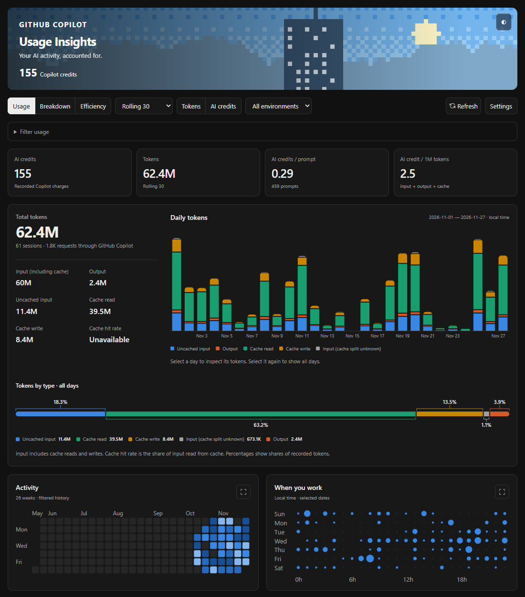
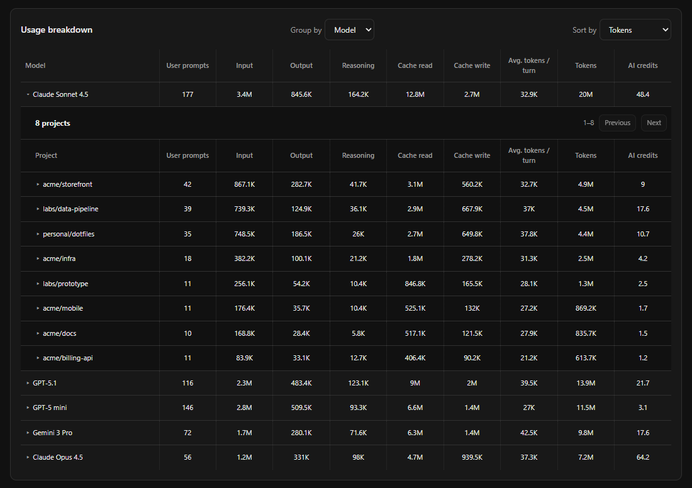
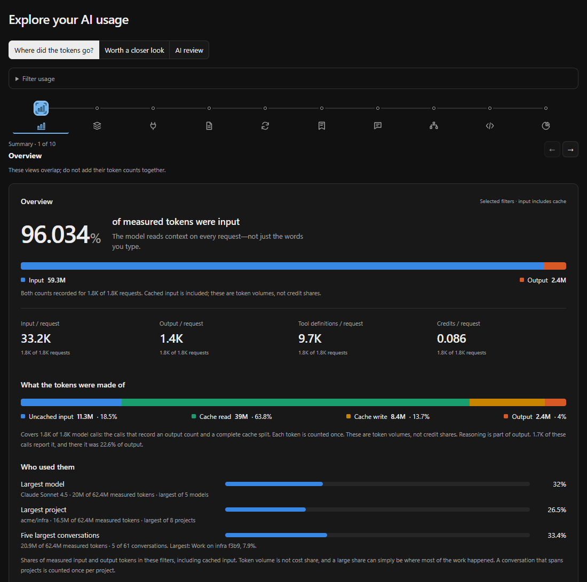
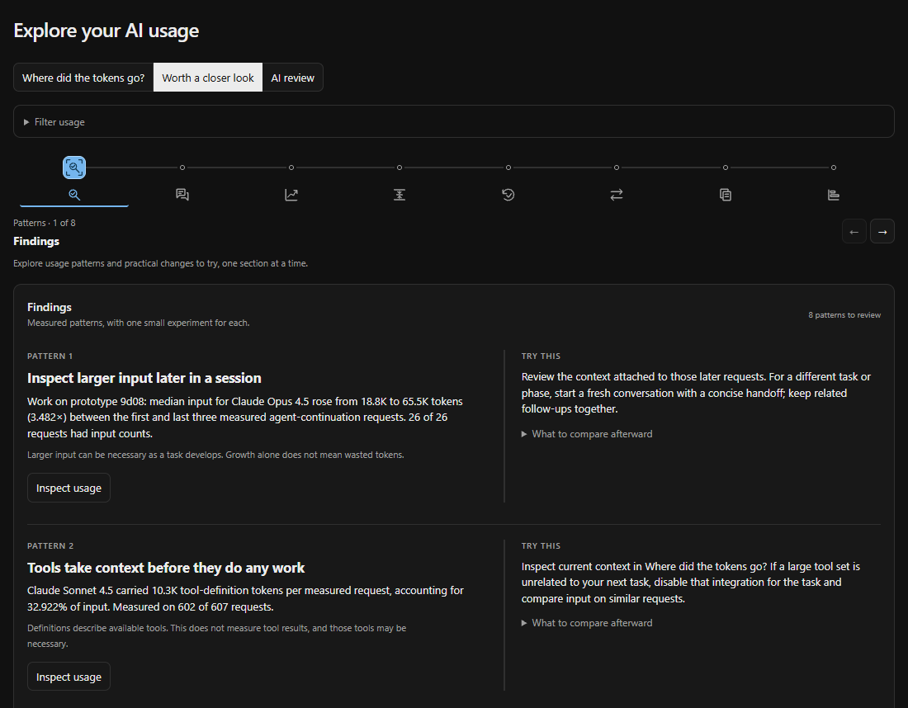
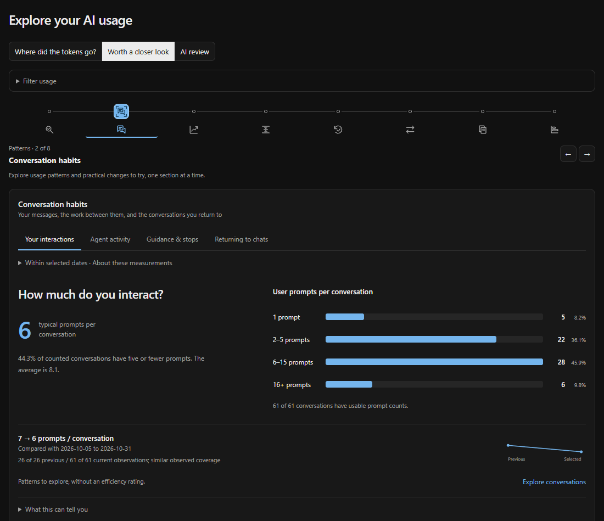
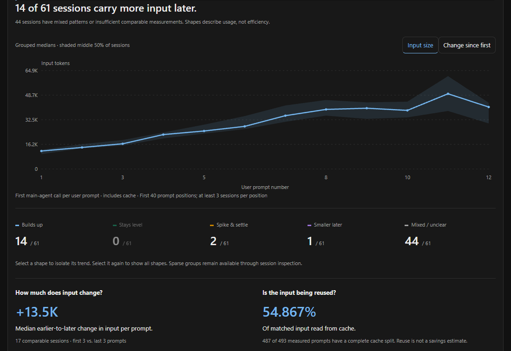

# Copilot Usage Insights

A local usage dashboard for the **GitHub Copilot desktop app**. Explore recorded tokens and AI credits by model, project, session, and date; inspect skills and MCP activity; and optionally ask Copilot to review your usage patterns.

Forked from [Orca Usage Insights](https://github.com/Etherll/orca-usage-insights) by [Etherll](https://github.com/Etherll). The original MIT license and copyright notice are preserved.



*Synthetic demo data. Screenshots show selected portions of the dashboard; no personal usage records are included.*

<details>
<summary>Explore Breakdown and Efficiency screenshots</summary>

**Usage breakdown** — Expand models into projects, sessions, and individual model turns to inspect recorded tokens and credits.



**Where did the tokens go?** — Explore input and output, cache use, and which models and projects account for the most tokens.



**Findings** — Review measured patterns alongside small experiments to try and guidance on what to compare afterward.



**Conversation habits** — See how you interact with the agent and how those patterns change across periods.



**Context growth** — Follow input across prompt positions, compare conversation shapes, and inspect cache reuse.



</details>

**Reviewing the repository?** Start with the [reviewer's guide](docs/reviewing.md) for a demo, the architecture, source map, checks, and decisions worth discussing. The [documentation index](docs/README.md) links the complete user and maintainer guides.

## Try the synthetic demo

With **Node.js 24 or later**, run this command from a local checkout:

```sh
npm run preview:demo
```

Open the printed localhost URL in your browser. Stop with Ctrl+C. The demo uses generated records and does not read your Copilot history. There are no npm dependencies to install. The browser preview exercises the dashboard; live host integrations and AI review need Copilot desktop.

## Install in GitHub Copilot desktop

Use the Copilot desktop app with canvas support, signed in to your GitHub account. No clone or npm commands are needed for marketplace installation.

1. Open **Customize**, then the marketplace settings control next to the marketplace dropdown. Add this repository; choose **main** if asked for a branch:

   ```text
   https://github.com/AndrewGodlewsky/copilot-usage-insights
   ```

2. Under **Customize → Installed → Add plugin**, enter this exact **Name**:

   ```text
   copilot-usage-insights@copilot-usage-insights
   ```

3. Install and enable the plugin. Start a **new session** and ask:

   > Open Usage Insights.

Use **Refresh** to reread usage and **Settings** to configure sources. See the [installation guide](docs/guide/installation.md) for troubleshooting, WSL and VS Code coverage, and local development installation. Keep only one installed copy of the plugin.

### Update an existing installation

In **Customize → Installed**, use **Update** in the Plugins section. Version **2.0.0** expands all Efficiency views with deeper cost, cache, compaction, reliability, and model-routing insights—including Credits / 1M tokens, cache read-back ratios, before/after context diffs, live MCP status on failing tools, and compaction markers on session curves—plus consistent clickable links between related views and Breakdown. Close and reopen Usage Insights after updating. If Copilot has not picked up the updated extension, fully quit and restart it. See [dashboard recovery](docs/dashboard-recovery.md) for the diagnosis, behavior, and limits.

## What the numbers mean

The dashboard reports available local records, not an authoritative account billing statement. Recorded zero credits and unavailable charges remain distinct. Copied journals and overlapping sources are deduplicated; missing history cannot be reconstructed. Efficiency findings describe patterns and coverage limits, not proof of wasted spend or guaranteed savings.

| Guide | What it explains |
| --- | --- |
| [Usage and accounting](docs/guide/usage.md) | Tokens, credits, filters, prompt grouping, and activity |
| [Efficiency views](docs/guide/efficiency.md) | Context growth, cache use, conversation habits, model changes, and other patterns |
| [AI review](docs/guide/ai-review.md) | Prepared evidence, model selection, optional excerpts, and review guidance |
| [Skills, MCP, and plugins](docs/guide/integrations.md) | Recorded activity versus the current host inventory |
| [Loading and diagnostics](docs/guide/diagnostics.md) | Refresh behavior, coverage, logs, and privacy details |

## Privacy and security

Usage accounting runs locally and does not modify Copilot’s source records. Prompt details are read on demand. An explicitly started AI review sends its prepared evidence to Copilot; targeted prompt excerpts are enabled by default and can be turned off in Settings. Review the prepared evidence and excerpt setting before sending.

The plugin runs with the permissions of the Copilot process. Its dashboard is served on a private, token-protected localhost URL. See [SECURITY.md](SECURITY.md) for data access, network boundaries, retained files, updates, and pause/disable instructions.

## Development and checks

Use Node.js 24 or later. There is no npm dependency installation step; the host supplies the Copilot SDK, and the YAML parser is vendored with its license.

```sh
npm run build
npm test
npm run validate:benchmarks
npm run validate:security
```

The build regenerates the committed `panel/index.html` and benchmark module. The security validator checks vendored-file integrity and CI pins offline; it does not look up new vulnerabilities. CI runs the build and tests on Windows, macOS, and Linux.

See [development and distribution](docs/guide/development.md) for releases and [AGENTS.md](AGENTS.md) for the mandatory version/notes workflow. Use the [reviewer’s guide](docs/reviewing.md) to trace the code, and the [decision backlog](docs/audit-followups.md) for measured trade-offs awaiting maintainer review.

## Credits and license

This project is derived from [Etherll/orca-usage-insights](https://github.com/Etherll/orca-usage-insights). Credit for the original Usage Insights project belongs to Etherll. This repository maintains the GitHub Copilot adaptation and subsequent changes.

The project uses the full, unmodified [MIT License](LICENSE), retaining the original `Copyright (c) 2026 Etherll` notice and the complete license text. Keep these notices with redistributed copies or substantial portions of the software. Marketplace installations include the root license, the local installer copies it, and the generated standalone dashboard embeds it in an HTML comment. Third-party components and data retain their respective licenses described below.

Users are responsible for their use of the software and any associated Copilot subscriptions, AI credits, API charges, or other third-party costs. The software is provided under the MIT License's warranty and liability disclaimers; third-party services remain subject to their own terms and fees.

The bundled [js-yaml](https://github.com/nodeca/js-yaml) parser retains its separate [MIT license and copyright notice](src/vendor/js-yaml/LICENSE); its [vendor README](src/vendor/js-yaml/README.md) records the package source.

The AI Review SDK adapter and accounting writer are adapted from [AndrewGodlewsky/copilot-enhance-prompt](https://github.com/AndrewGodlewsky/copilot-enhance-prompt), with its [MIT notice](licenses/enhance-prompt-LICENSE) retained in marketplace and local installations.

Selected benchmark data is adapted from [Aider](https://github.com/Aider-AI/aider) under Apache License 2.0. Its [full license, attribution, and modification notice](licenses/aider-Apache-2.0.txt) are retained in marketplace and local installations and embedded in the standalone dashboard. Inclusion does not imply Aider's endorsement.
