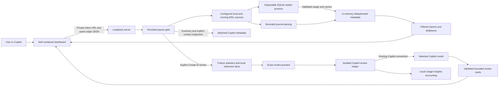
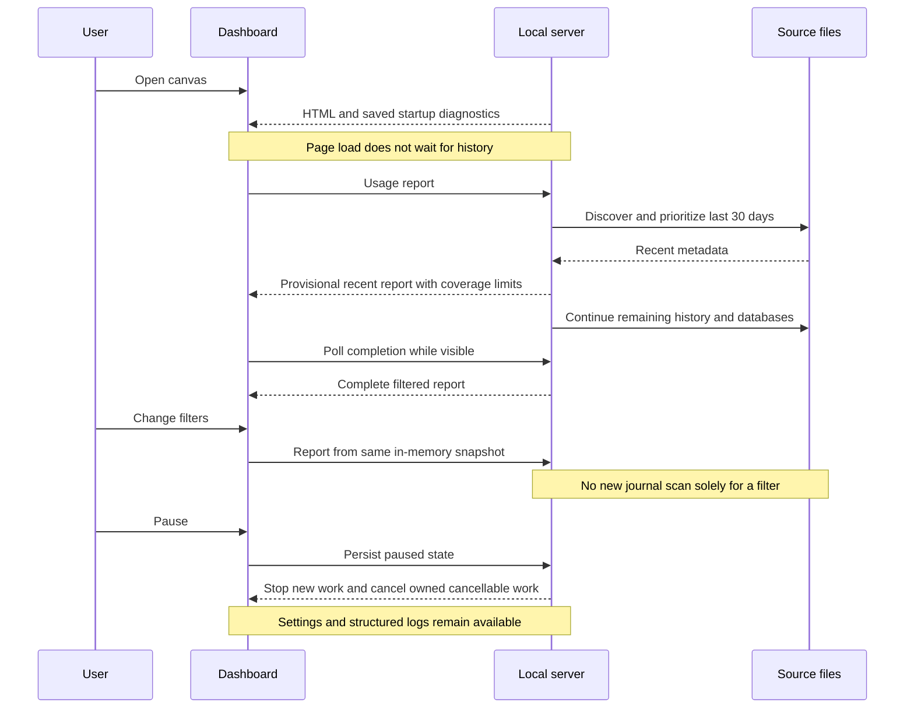

# Security and performance review — 2026-11-17

This review starts at `93117a6` (v0.1.110, fetched `origin/main`). The working tree was clean. Changes are on `audit/security-performance`; no prior edits were overwritten. This audit does not publish, install into a user's Copilot setup, or change the version.

Release follow-up: the maintainer subsequently authorized v0.1.111 on `main`. It includes the audit changes and the [journal-integrity decision](journal-integrity.md) from issue #7. Release checks passed 629 tests with one POSIX-only skip, plus all six 100,000-record scan tests. The other functionality decisions remain open in the [follow-up index](audit-followups.md).

The aim is to preserve accounting and functionality while reducing attack surface, unnecessary work, and load-time stalls. Measurements use generated records and temporary directories, never personal histories or paid inference. Browser/desktop automation was not authorized: UI measurements below cover JavaScript and DOM operations in a VM fixture, **not browser paint or a live Copilot canvas**.

## Conclusions

- A malformed SQLite source could exhaust the old reader through a recursive SQL view. Rejecting unexpected schemas closes that demonstrated path. Uncached usage reads now run in a cancellable child with time/output bounds; this is not an OS sandbox or total-memory cap.
- Prompt-attribution algorithms contained repeated whole-history and repeated shared-group work. Replacing these with indexes materially improves pathological histories without changing costs, exclusions, ordering or filter semantics.
- Unchanged archived databases were reread, and a 33-session desktop-title lookup switched to a full table scan. Safe metadata caching and selective indexed lookup remove that work. Active WAL databases are deliberately not cached on file metadata alone.
- Hidden dashboard sections were regenerated during interactions in other tabs. Deferring those renders and reusing tooltip layout avoids work without dropping visible content.
- A 100,000-session response shrank from 76.1 MB to 17.7 MB with lossless encoding. Report caches now have a size budget as well as an entry limit, and closed session filters defer their thousands of option elements. All sessions remain available.
- There is now a persistent pause control, explicit host-runtime status, offline vendored-code integrity checks, pinned read-only CI, and a smaller local install. Pause is not a replacement for disabling a compromised plugin and restarting its host.
- Full-fidelity history remains proportional to retained records. No finite synthetic test proves arbitrary histories will fit RAM. Architectural and feature-reducing options are separated below; no history or feature was silently removed.

## Download and execution inventory

| Component | Origin and update owner | Execution/access |
| --- | --- | --- |
| Plugin JavaScript and compiled dashboard | This repository/release | Runs as the Copilot user; self-contained dashboard has no remote assets |
| js-yaml 5.5.0 | Vendored official browser ESM artifact, MIT; maintainer updates | Parses bounded skill frontmatter with CORE_SCHEMA and alias/depth limits |
| Node.js and SQLite | Copilot runtime; host updates | Files, loopback HTTP, SQLite, worker/process APIs |
| Copilot SDK and CLI helper | Attached Copilot installation | Host metadata/catalog and explicitly requested isolated AI review |
| GitHub CLI | Existing system installation | Same-account verification when needed; credentials are not saved by this plugin |
| WSL and Python sqlite3 | Existing running distributions | Optional discovery/database fallback; no stopped distro is started or software installed |
| Benchmark facts and reviewer guides | Bundled reviewed repository data | Local reads only; source URLs are provenance, not automatic fetches |
| Build/test actions | GitHub Actions, pinned commits | CI only, contents read permission; weekly Dependabot update proposals |

`package.json` has no npm dependencies or development dependencies. That reduces installation surface but **does not** make `npm audit` a complete security check: the vendored parser and host runtime/SDK sit outside a lockfile. [security-dependencies.json](../security-dependencies.json) records the inventory. During this review the vendored parser was byte-compared to the official npm tarball, its tarball integrity verified, and its SHA-256 recorded. Builds verify those bytes offline; they do not discover new advisories.

Local installation omits `src/panel` (already compiled into `panel/index.html`) and non-runtime guide examples/README. Runtime guide files, generated benchmark facts, licenses, backend imports, and security guidance remain installed and are tested from an isolated temporary installation. Marketplace delivery can include the full Git checkout; this change does not promise that the host downloads a reduced archive. An old browser-debug snapshot was removed and its directory ignored.

The final isolated local-install measurement was **974,460 bytes across 70 files**, down from **1,283,606 bytes across 78 files** at the base commit: **24.1% smaller**. This includes new security notices; it is an installed runtime-file comparison, not a marketplace download measurement. The generated dashboard itself grew from 452,340 to 466,634 bytes as the controls and lossless decoder were added.

## Boundaries and data flow



Prompt text is not retained in the statistics snapshot. Viewing a prompt reads its original journal on demand. A user-started AI review may make one bounded excerpt follow-up if the saved setting permits it. This is a real privacy choice: the excerpts can contain private text even though the first-pass statistics use aliases. Sources and local prompt details are intentionally visible to that user in the dashboard; they are not included in structured diagnostic exports.



### Threat model and controls checked

| Boundary | Checked behavior | Limit |
| --- | --- | --- |
| Web page → loopback API | 256-bit random token, exact Host/Origin checks, JSON-only bounded request bodies, no permissive CORS | Same-user malware or a leaked token is outside this boundary |
| Dashboard text → executable markup | Escaping of source names, tooltips and evidence; validated review schemas; script hash CSP added | Styles retain inline permission for generated charts; no claim of browser penetration testing |
| Request ID → prompt file | Snapshot-selected file, real-path containment, symlink/junction/traversal tests | Configured source homes themselves are trusted; remote mounts can be slow or hostile |
| SQLite file → queries | Read-only transaction, expected ordinary tables, cancellable usage-reader child with 30-second deadline and bounded output | No OS sandbox or total-RSS cap; a valid source exceeding limits is explicitly reported as incomplete |
| Settings → shell/system tools | Validated paths; argument arrays rather than shell interpolation; bounded WSL processes | Inherited OS/Copilot privileges are not reduced by this plugin |
| Review → account/model | Same-account, provider/policy/model/reasoning checks, expected-model validation and frozen preview | Only mocked SDK calls exercised; actual host compatibility remains a manual check |
| Review → tools/files | Tool-free helper, disabled extensions/config/skills/MCP/memory, verified isolation | SDK-level isolation, not an OS sandbox; prompt injection can still affect prose quality |
| Review → usage retention | Charges retained even on cancellation/failure, cleanup failures explicit | Failed cleanup/accounting can retain temporary transcripts; do not promise erasure |
| Logs → shared export | Structured allowlisted fields, bounded ring/files, no raw error text/prompts/paths/accounts | Review attachments before sharing; external/raw logs are a separate privacy risk |
| Install/update → filesystem | Staged owned destination, atomic replacement, unrelated-path/symlink rejection | A malicious installed release can execute with user permissions; trust source and review changes |

## Findings and remediation

| Priority | Finding and evidence | Resolution |
| --- | --- | --- |
| High availability impact; requires crafted configured source | A 4 KiB SQLite database whose expected usage object was a recursive view exhausted a 128 MiB child heap in about 620 ms | Ordinary-table checks and a disposable usage-reader process; read-only and trusted-schema settings alone were insufficient |
| Host maintenance requirement | Development Node v24.22.1 predates the reviewed Node security release | Settings reports dated baseline; maintainer/user instructions explain host updates and pause/disable |
| Defense in depth | Executable inline scripts were broadly allowed by CSP | Only exact shipped script hashes are permitted; inline event handlers disallowed; served-byte hash test |
| Supply chain maintenance | Vendored dependency outside npm audit and mutable CI action tags | Version/hash/license inventory, offline build gate, exact action commits, read-only CI and update proposals |
| Operational control gap | No persisted way to suspend all new source/review operations | Settings pause; cancelled owned work and discarded late results; resume fresh; races and startup tested |
| Pause persistence race | A late general-settings save in another instance could overwrite a new pause | Separate atomic pause state; deterministic cross-instance pause/resume regression; malformed state blocks new source and AI requests |
| High performance impact | Attribution repeatedly traversed unrelated histories/shared charge groups | Indexed/partitioned passes and membership sets, exact-result comparisons and large tests |
| High performance impact | Unchanged DB rereads and desktop-title threshold cliff | Conservative cache and selective queries with WAL/change/force regression tests |
| Medium performance impact | Hidden tables/graphs and tooltip layout regenerated on unrelated interactions | Render only selected tab; reuse tooltip layout until data/format/viewport changes |
| Resource pressure | All installed skill versions read concurrently | Shared bounded 16-read queue, same path/stat cache and values |
| Resource pressure | Twelve retained reports could each contain tens of megabytes; global string interning bounded entries but not bytes | 16 MiB decoded-serialization proxy for report-cache admission, plus a 4 MiB character budget for interned strings; neither is a total-heap cap |
| Transport and hidden DOM cost | Repeated keys/defaults inflated session rows; closed filters created all native session options | Lossless versioned report encoding; populate large session choices when filters open, preserving programmatic selection |

The [Node advisory](https://nodejs.org/en/blog/vulnerability/november-2026-security-releases/) is a host update signal; the plugin's cleartext HTTP/1 loopback server is not an exposed HTTP/2 or HTTPS server. Do not equate every upstream CVE with a demonstrated plugin exploit. js-yaml 5.5.0 is outside the old versions listed in [GHSA-mh29-5h37-fv8m](https://github.com/nodeca/js-yaml/security/advisories/GHSA-mh29-5h37-fv8m); this is a dated advisory review, not proof against undiscovered issues.

## Efficiency map

| Stage / visible section | Work and existing bounds | Audit action / remaining cost |
| --- | --- | --- |
| Canvas registration/loading | Lazy usage/review imports; immediate self-contained HTML | Keep independent of source scans; no CDN or model call on load |
| Source discovery | Journal directories, VS Code profiles/workspaces, running WSL; bounded process/IO work | Repeated directory metadata remains necessary to discover new sessions |
| Journals | Streaming, 256 KiB reads, 8 MiB line cap, 16-way reads, incremental append | Full-prefix verification preserves detection of historical edits; cost measured below |
| SQLite/desktop titles | Recorded usage fallback and title enrichment | Cached unchanged safe usage DBs; selective titles; both read in cancellable children; no metadata cache for WAL/network uncertainty |
| Deduplication/provider attribution | Session/request/event IDs, copied journals, conservative provider evidence | Preserve copied-log and ambiguous-provider behavior; no estimates replace recorded credits |
| Prompt costs/conversation habits/context growth | Join user prompts and all linked work before filtering | Remove quadratic linking/shared-group work; large synthetic exact invariants |
| Usage graphs/models/projects | Aggregated dates/types/models/projects, limited top lists | Reuse reports, no hidden Breakdown/Efficiency work; long histories still affect aggregate size |
| Breakdown/drilldowns | Paginated requests/sessions, skill details; full top-level group lists | No hidden render; full visible project/skill list can still be large |
| Efficiency topics | Bounded context curves/examples and selected detail | Uses existing snapshot; context inspection stays explicit |
| AI review | Explicit preparation, bounded candidates, 48 KiB input, local guides/benchmarks, cached catalog | Clone only selected candidate records; no history-by-benchmark fetch or automatic inference |
| Settings/diagnostics | Small local JSON, bounded logs, periodic refresh only while visible | Offline security inventory/status; persistent pause; no new telemetry/polling |
| Installation/build | Self-contained generated panel, no npm install tree | Omit duplicate source payload; verify imports/guides from temporary install |

### Reproduction and performance interpretation

Use [source measurements](source-audit-2026-11-17.md), [report-scale measurements](report-scale-audit-2026-11-17.md), and [panel measurements](panel-audit-2026-11-17.md) for fixtures, commands and comparisons. Source-scale commands use the existing synthetic generator:

```powershell
node --expose-gc scripts/benchmark-performance.mjs --scale --records=50000 --days=180 --empty=2000 --payload=realistic --seed=7
node --expose-gc scripts/benchmark-performance.mjs --scale --records=100000 --days=180 --empty=2000 --payload=realistic --seed=7
npm run benchmark:reports -- --n=100000 --case=long
node --expose-gc scripts/benchmark-report-scale.mjs --n=100000 --case=normal --repeat=1 --wire
```

These can create gigabytes of synthetic journals in an owned temporary directory; normal completion cleans them up. Do not use `--local` for reproducible shared measurements. Wall times depend on disk, antivirus, CPU, Node and background load. Keep an unchanged baseline checkout and use each script's `--repo` option for comparisons; never overwrite a dirty worktree to obtain one. Operation-budget tests are more stable than strict millisecond assertions in CI.

The 100k realistic fixture occupied about 3.54 GiB of journals. Its cold scan stayed near 7.3 seconds and retained about 418 MiB of metadata. The final 50k sample was slower than baseline (4.39 versus 3.75 seconds); no broad journal-scan speedup is claimed. First complete 7-day loading in the 100k fixture fell from 9.78 to 9.34 seconds. These are single-machine measurements with disk/cache/GC variability.

The strongest measured gains come from specific repeated-work cases: 10k copied-journal grouping fell from 10.35 seconds to 221 ms; 10k shared billing-group reports fell from 1.34 seconds to 102 ms. Completed 200k-prompt stress runs preserved accounting invariants. An unchanged 100k-row archived database scan fell from 840 to 97 ms, while cold scanning became slower (825 to 1,342 ms) and retained heap rose from 61.7 to 87.6 MiB. The process boundary adds startup/transfer cost but lets timers and cancellation run during native SQLite work. Active WAL databases deliberately remain uncached. These fixtures are separate; do not add their times or memory figures.

The compact protocol reduces response bytes rather than the final decoded session count. Its encode/decode cost is measured separately in the report audit; a smaller payload is not proof of faster browser paint. The report cache admits at most 12 entries and a 16 MiB estimated decoded serialized-size budget. Oversized reports are still built and returned in full but are not retained in that cache. Temporary response allocations and the canonical history remain outside this budget.

Desktop-title reads also use the disposable child, with no spawn when `data.db` is absent. This adds about 50 ms for small selections; 100k titles took 274 ms in the child versus 183 ms directly in the final sample. This is accepted for cancellation and main-loop responsiveness, not described as a throughput improvement. Removed/disabled VS Code workspace metadata is evicted rather than retained indefinitely.

## Decisions that would change functionality

No such reduction was applied in this audit.

The maintainer requested detailed GitHub handoffs for these decisions. [Follow-up issues and implementation criteria](audit-followups.md) cover every option below, including storage architecture and large-list navigation. They are not approval to change defaults or discard data.

| Option | Measured reason to consider it | What would be lost / decision |
| --- | --- | --- |
| Verify only the tail of an appended journal | A 226-byte append to a 256 MiB journal required about 130–137 ms to hash the consumed prefix, versus about 0.9 ms for an unchanged scan | Could miss an edit earlier in that file and show wrong totals. **Keep full verification.** Saving this time is not worth silently weakening accounting |
| Keep only recent history in memory | 50k realistic requests already retained about 210 MiB before report caches; memory scales with metadata | Immediate all-time drilldowns and some cross-date prompt linkage would be lost unless older files are reloaded. Do not make this default without user approval and new coverage semantics |
| Omit detailed prompt/tool timelines | Attribution and timeline metadata make up part of retained history | Could reduce memory but remove conversation/context/delegation evidence. No isolated savings figure yet: do not claim a percentage or remove it on speculation |
| Skip background older-history loading | Recent data can appear before full history verification | Wider ranges would need an explicit load and recent prompt coverage could remain provisional. Requires an explicit UX/accounting decision |
| Skip parsing unused event bodies | One 50k experiment reduced cold scan 3.75 → 3.21 seconds (14.3%), with unchanged retained memory | Can miss malformed-JSON diagnostics in unused events. Keep full validation: this is a modest speed gain with a real coverage loss, not a demonstrated drastic improvement |

A persistent validated on-disk index or column-oriented metadata could preserve functionality with lower retained RAM, but would introduce a new storage format, invalidation/migration/security burden, and additional local data. That is a separate architectural decision, not a quick cache of stale dashboard values. The user's requirement to avoid showing old cached reports remains intact.

## Coverage and remaining verification

Final local checks on Windows/Node v24.22.1:

- `npm run build` passed and regenerated `panel/index.html`.
- `npm test` after the follow-up hidden-drilldown fix: **624 tests, 623 passed, one POSIX-only skip, zero failures** (14.30 seconds).
- `USAGE_SCALE_RECORDS=100000 node --test tests/scale.test.mjs`: **6/6 passed** (37.36 seconds), covering incremental/fresh accounting equivalence, unchanged snapshots, appends, ranges and a retained-memory budget.
- Report benchmarks exercised **200,000 prompts**, and **147 baseline-versus-updated report comparisons** preserved complete results across synthetic cases and filters. See the report audit for commands and fixture shapes.
- `npm run validate:security`, `npm run validate:benchmarks`, and `git diff --check` passed. The validators operate offline. Temporary-install tests load the installed backend modules and review guide without touching the user's plugin.
- All 78 relative Markdown links checked across the README, security guide, audit documents and follow-up index resolved. Mermaid diagrams received static review; no browser rendering was performed.

The review followed entrypoints through `src/extension.mjs`, all `src/node` modules, all core accounting/aggregation/reference modules, panel renderers/controllers/styles, reviewer guides, benchmark data/validation, build/local-install scripts, manifests, licenses and CI. Existing tests were read and extended around demonstrated faults and boundaries. Generated panel code was regenerated from reviewed sources. Vendored parser provenance/integrity and its configured parsing surface were checked; this is not a claim to have independently re-proved every line of the upstream parser, Node, SQLite, SDK, CLI, OS or browser engine.

Manual follow-up must check the real Copilot host's runtime compatibility, including the embedded-runtime database child bootstrap, CSP-loaded canvas, pause/resume during real work, visual layout/focus/theme, and remote/WSL performance. No desktop/browser, paid inference, real GitHub account validation or private-history test was performed. Windows cannot execute the POSIX-only alarm regression; CI's Linux/macOS jobs are configured to exercise that path, but were not run here. See [SECURITY.md](../SECURITY.md) for user actions and the recurring maintainer checklist.
