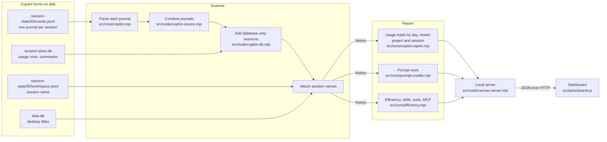
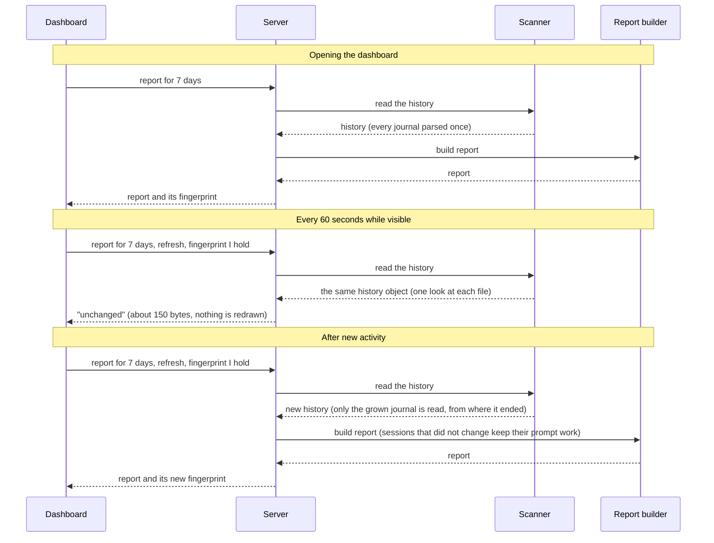
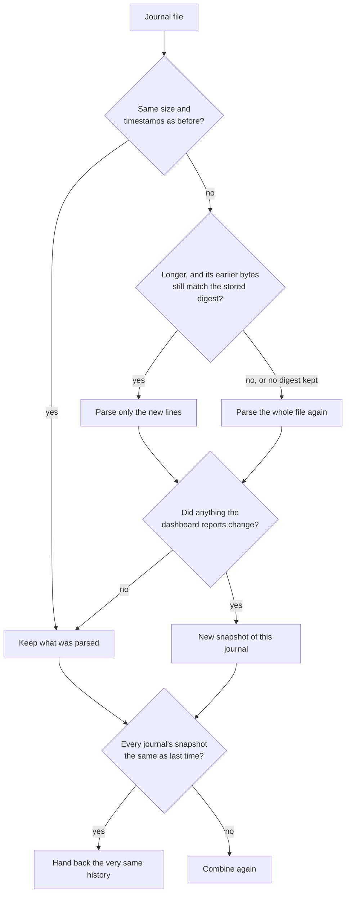
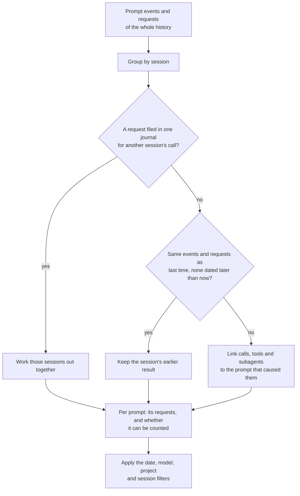

# Efficiency review

A review of every stage between Copilot's files on disk and the numbers on the dashboard, aimed at someone who uses Copilot all day and keeps months of history. It covers how the plugin works, what each stage cost, what was changed, how the changes were checked, and which further gains would mean giving something up.

Starting point: version 0.1.70. It picks up the remaining costs listed in the [dashboard opening review](performance-review-2026-11-15.md). No feature, number or message on the dashboard was changed. The old and the new code were run side by side on generated histories and produced identical output in every comparison (see [How sameness was checked](#how-sameness-was-checked)).

## Result

A heavy history: 100,020 requests in 3,248 session journals (597 MB), plus 4,000 session folders without a journal. Times are for the real local server, called the way the dashboard calls it.

| What the user does | Before | After | Faster |
| --- | ---: | ---: | ---: |
| Open the dashboard (first read of everything) | 20.5 s | 6.91 s | 3.0× |
| 60-second refresh, nothing new | 11.7 s | 184 ms | 64× |
| 60-second refresh after new activity | 12.4 s | 657 ms | 19× |
| Change the range to all time | 5.99 s | 270 ms | 22× |
| Change it back to 7 days | 5.75 s | 7.1 ms | 810× |
| Sent on a refresh with nothing new | 443 KB | under 1 KB | |
| Memory held for the history | 917 MB | 369 MB | 2.5× less |

Before, the dashboard reread and recomputed everything on every request, so each 60-second refresh cost as much as a filter change, whether or not anything had happened. Now a refresh costs one look at each file, and work is redone only for what changed.

What remains slow is the very first read after the extension starts: every journal has to be parsed once. The options for that are in [Decisions for you](#decisions-for-you).

## How the plugin works



The extension starts a small HTTP server on the local machine and shows the dashboard page in a Copilot canvas. The page asks the server for a report; the server asks the scanner for the history, builds the report for the chosen filters, and sends it as JSON. Nothing is stored between runs: the history exists only in memory and is rebuilt from Copilot's own files.

Two kinds of data come out of a journal. A **request** is one model call with its tokens and credits (a `session.usage_record` line). **Prompt events** are the surrounding lines (messages, turns, tool calls, subagents) that let the plugin work out which requests one prompt caused. A journal line's text is never kept, only identifiers, counts and times.

### What happens on each request



### How one journal is handled on a later look



### What is kept, and what makes it stale

Each layer keeps its last answer and hands back the very same object when its inputs are the same objects. The next layer only has to compare identities to know that nothing changed.

| Layer | Kept | Thrown away when |
| --- | --- | --- |
| Session name | Name read from `workspace.yaml` | The file's size or timestamps change; a manual Refresh |
| Journal | Parsed requests and events | The file's size or timestamps change. A longer file is continued if its earlier bytes match a stored digest, otherwise read again |
| Combined history | All journals joined | Any journal produced a new snapshot, or the set of journals changed |
| Scan result | The object handed to the server | Anything it reports differs: requests, activity, a session name, a source's state |
| Prompt work per session | Which requests each prompt caused | The session's events or requests change, or it has entries dated later than now |
| Built report | One per filter, up to 12 | A new scan result, a new local day, a clock set back, or an entry dated later than the report coming due |
| Sent report | Fingerprint of what the dashboard holds | Any difference in the content, including installed skill versions and display settings |

Copilot's two databases are the exception: they are read on every look, because SQLite keeps recent changes in a side file and Windows does not reliably update a database's timestamps while Copilot has it open. Their rows are compared with the previous read so that unchanged rows stay the same objects.

### How requests are tied to prompts



This is done for the whole history before any filter, because a prompt's requests can fall on either side of a date boundary and a project is listed with a prompt count of zero only if it has had a prompt at some time.

## Section by section

Figures in this section are from the 100,000-request history unless noted. "Before" is version 0.1.70.

### Noticing what changed (`src/node/copilot-source.mjs`)

Before, a look at an unchanged history took 7.71 s. Each look reread and reparsed every `workspace.yaml`, built fresh lists from every journal, combined them through hash tables, copied every request to attach its session name, and so handed the report builder objects it had never seen. Folders were visited one at a time.

Now each session folder costs two file-status calls, 16 folders at a time. Names are kept by file status. A journal whose status is unchanged is not opened. If no journal produced anything new, the earlier combined history and the earlier result object are returned as they are. Session names are written onto the request objects in place, so a rename changes one field instead of copying 100,000 objects.

Cost now: about 220 ms for 7,248 folders, nearly all of it the operating system answering file-status calls.

### Reading a journal (`src/node/copilot-source.mjs`, `src/core/copilot.mjs`)

Before, a journal was hashed once to check its earlier bytes and read a second time to parse it, lines were cut out by scanning for separators in JavaScript, and each tool call was kept as three objects. Every parsed line kept its own copies of identifiers that repeat thousands of times.

Now a journal is read once, in 256 KB blocks from a small pool of buffers; lines are located with the built-in byte search; the digest is fed from the same blocks. Repeated identifiers (session, model, tool, call IDs) are stored once and shared. A tool call is one object. The parser counts changes to what it reports, so appended lines of types the dashboard does not read leave the journal's snapshot, and everything built from it, untouched.

A digest is kept only for journals written within the last day or seen to change. A journal last written long ago rarely grows, so it is read without one; if it does change it is read again from the start, and from then on continued. This saves the hashing (7–11% of a first read on a processor with hardware SHA-256, more without) and lets such journals drop the tables their parser keeps for recognising repeated lines (about 14% of memory).

Cost now: a first read runs at 99–112 MB/s on compact journals and 265 MB/s on journals with realistic message and tool payloads (before: 35–38 and 81). What remains is mostly `JSON.parse` on every line.

### Combining journals (`src/node/copilot-source.mjs`)

Journals are combined because a session can exist twice, as a copy in another Copilot home or after a move, and must count once.

Before, every entry of every journal went through a hash table on every look. After the first round of changes that was still true after any change, and it had become the largest part of a refresh: 0.6 s per refresh at 100,000 requests.

Every entry is filed under a session ID, so two journals can repeat each other only if they share a session ID. Each journal now reports the session IDs it uses. Journals that share none with any other are joined end to end, and only the few that do are reconciled entry by entry. The order of the result is the same as before.

Cost now: about 20 ms after a change at 100,000 requests; none when nothing changed.

### Copilot's databases (`src/node/copilot-db.mjs`)

`session-store.db` supplies usage for sessions that have no journal, and summaries used as names. `data.db` supplies titles from the desktop app.

Before, every usage row was fetched and converted on every look, then discarded if its session had a journal, which for most histories is every row. Titles were fetched with one query per session.

Now one query lists the distinct sessions in the usage table; rows are fetched only if some session lacks a journal. Titles are read in one query when more than 32 sessions are wanted.

Cost now, with 100,000 usage rows in 4,000 sessions: usage 130 → 25 ms, titles 74 → 3.9 ms. If the database does hold sessions without journals, reading those rows still costs about 0.5 s per 100,000 rows on each look (see [Decisions for you](#decisions-for-you)).

### Usage totals (`src/core/copilot-report.mjs`)

Before, a report took about 6.05 s whatever the range, because most of its time went into work that does not depend on the range (prompt work, below). The totals themselves made a `Date` for every request to find its local day, added credits as `BigInt` values, and went over the requests several times, once per section.

Now a request's local day comes from a small table of day boundaries, filled as days are first seen and exact across time zones and daylight-saving changes. Credits are added as ordinary numbers and continue as a `BigInt` only when a total would pass the range numbers add exactly. Requests usually arrive grouped by session, day and model, so the bucket for "same as the previous request" is remembered instead of looked up. Calendar cells are made only for the 182 days that are drawn, while the streak still counts every day.

Cost now: 123–275 ms depending on the range. Each request is still visited once per report; see [Looked at and left alone](#looked-at-and-left-alone).

### Prompt work (`src/core/prompt-credits.mjs`)

Linking requests to prompts was 87% of every report before (profiled at 20,000 requests), redone in full each time.

Now the result is kept per session between reports of the same scanner. A session is worked out again only if its events or requests are different objects from last time, which after a refresh means the one session that was active. A result is not reused for a session that has entries dated later than now, and the whole set is reused across filter changes as long as nothing dated later has come due.

Cost now: about 1.00 s once, in the first report after start; about 85 ms after a journal changes; nothing on a filter change.

### Efficiency, skills, tools and MCP (`src/core/efficiency.mjs`, `src/core/copilot-report.mjs`)

The same changes as for usage totals: one pass, remembered buckets, exact credit totals without a `BigInt` per request. The set of sessions whose activity may be attributed is computed once per report and shared instead of once per section.

### Server (`src/node/canvas-server.mjs`, `src/node/skill-version.mjs`)

Before, every request rebuilt its report and sent it in full: 443 KB to 2.8 MB each minute at this size.

Now reports are kept per filter for the current scan result. Each sent report carries a fingerprint of its content. The dashboard sends back the fingerprint it holds on a timed refresh; if the new content has the same fingerprint the server answers "unchanged" in about 150 bytes. Installed skill versions are still read from disk on every request, now side by side and remembered by file status, and they are part of the fingerprint, so an upgraded skill shows up on the next refresh.

### Dashboard (`src/panel/panel.js`)

Before, every refresh replaced the whole page content, including filter menus and the banner, even when nothing differed.

Now an "unchanged" answer updates the two timestamps and the clock in the banner and nothing else. Filter menus are rebuilt only when their choices change. Measured in a browser with 20,000 requests: a filter change took 1.2–1.4 s before and 54–63 ms after; a timed refresh took 2.8–3.1 s and downloaded 484–738 KB before, and 48–71 ms with nothing downloaded after. No redraw or view switch blocks the page for more than 50 ms.

### Detail pages and prompt text (`src/core/copilot-report.mjs`, `src/node/request-prompts.mjs`)

Session and request pages reuse the session labels of the current history. Prompt text is read from the journal only when a request is expanded; the reader now makes one pass and parses only lines that can contain the text it needs.

### Start of the extension (`src/node/canvas.mjs`)

The server code is loaded when the dashboard is first opened, not when a Copilot session starts. That saves 35–60 ms and about 4 MB in every Copilot session that never opens the dashboard.

## Measurements

Measured on one Windows machine with other work running on it, so compare the columns, not the absolute times. Each "before" and "after" pair ran back to back on the same generated history. Run-to-run variation was up to about 30% in both columns: an earlier run of the 100,000-request pair measured 12.7 s → 4.2 s for the first read and 11.1 s → 0.19 s for an idle refresh. The generator (`scripts/synthetic-history.mjs`) writes journals shaped like Copilot's, with long identifiers, subagents, tool calls, replayed lines, damaged lines, non-Copilot providers and sessions in several projects, and dates each file as its session ended.

### 100,000 requests

100,020 requests in 3,248 session journals (597 MB), plus 4,000 session folders without a journal. Memory: 9,609 → 3,872 bytes per request.

| Stage | Before | After | Faster |
| --- | ---: | ---: | ---: |
| Read every journal (cold scan) | 17.3 s | 6.03 s | 2.9× |
| Look again, nothing changed | 7.71 s | 220 ms | 35× |
| Look again after one journal grew | 7.72 s | 230 ms | 34× |
| First all-time report | 7.25 s | 1.27 s | 5.7× |
| All-time report after one journal grew | 6.76 s | 553 ms | 12× |
| Report, Today | 6.19 s | 123 ms | 50× |
| Report, 7 days | 6.05 s | 127 ms | 48× |
| Report, 90 days | 5.42 s | 161 ms | 34× |
| Report, all time | 6.02 s | 275 ms | 22× |
| Report, all time, one model | 5.42 s | 181 ms | 30× |
| Sessions of one model (detail page) | 66 ms | 43 ms | 1.6× |
| Prompt text of one session (read on demand) | 19 ms | 15 ms | 1.3× |

### 20,000 requests

20,034 requests in 641 session journals (120 MB), plus 2,000 session folders without a journal. Memory: 9,583 → 3,889 bytes per request.

| What the user does | Before | After | Faster |
| --- | ---: | ---: | ---: |
| Open the dashboard (first read of everything) | 5.16 s | 1.09 s | 4.7× |
| 60-second refresh, nothing new | 3.46 s | 48 ms | 72× |
| 60-second refresh after new activity | 3.50 s | 110 ms | 32× |
| Change the range to all time | 1.22 s | 45 ms | 27× |
| Change it back to 7 days | 1.22 s | 3.5 ms | 348× |
| Sent on a refresh with nothing new | 213 KB | under 1 KB | |
| Memory held for the history | 183 MB | 74 MB | 2.5× less |

| Stage | Before | After | Faster |
| --- | ---: | ---: | ---: |
| Read every journal (cold scan) | 3.18 s | 1.07 s | 3.0× |
| Look again, nothing changed | 1.81 s | 58 ms | 31× |
| Look again after one journal grew | 2.06 s | 65 ms | 32× |
| First all-time report | 1.24 s | 215 ms | 5.8× |
| All-time report after one journal grew | 1.31 s | 59 ms | 22× |
| Report, Today | 1.10 s | 21 ms | 54× |
| Report, 7 days | 1.08 s | 11 ms | 95× |
| Report, 90 days | 1.13 s | 24 ms | 47× |
| Report, all time | 1.18 s | 33 ms | 36× |
| Report, all time, one model | 1.11 s | 21 ms | 53× |
| Sessions of one model (detail page) | 11 ms | 3.3 ms | 3.2× |
| Prompt text of one session (read on demand) | 17 ms | 9.1 ms | 1.8× |

### 10,000 requests with realistic payloads

Real journals are mostly message and tool text, about 36 KB per request. 10,040 requests in 328 session journals (357 MB), plus 2,000 session folders without a journal. Memory: 9,452 → 3,906 bytes per request.

| What the user does | Before | After | Faster |
| --- | ---: | ---: | ---: |
| Open the dashboard (first read of everything) | 4.80 s | 1.31 s | 3.7× |
| 60-second refresh, nothing new | 1.79 s | 57 ms | 31× |
| 60-second refresh after new activity | 1.74 s | 95 ms | 18× |
| Change the range to all time | 556 ms | 45 ms | 12× |
| Change it back to 7 days | 497 ms | 4.0 ms | 124× |
| Sent on a refresh with nothing new | 167 KB | under 1 KB | |
| Memory held for the history | 91 MB | 37 MB | 2.4× less |

| Stage | Before | After | Faster |
| --- | ---: | ---: | ---: |
| Read every journal (cold scan) | 4.39 s | 1.35 s | 3.3× |
| Look again, nothing changed | 1.85 s | 59 ms | 32× |
| Look again after one journal grew | 1.87 s | 66 ms | 28× |
| First all-time report | 599 ms | 169 ms | 3.5× |
| All-time report after one journal grew | 705 ms | 35 ms | 20× |
| Report, Today | 507 ms | 11 ms | 48× |
| Report, 7 days | 490 ms | 8.8 ms | 56× |
| Report, 90 days | 457 ms | 13 ms | 35× |
| Report, all time | 605 ms | 16 ms | 38× |
| Report, all time, one model | 492 ms | 11 ms | 44× |
| Sessions of one model (detail page) | 11 ms | 2.0 ms | 5.4× |
| Prompt text of one session (read on demand) | 195 ms | 34 ms | 5.7× |

## How sameness was checked

Speed was only accepted where the output stayed identical. Five independent checks were used.

1. **The existing tests.** All 266 tests of version 0.1.70 pass unchanged.
2. **Known totals.** The generator counts what it writes (requests, tokens, credits, prompts, tools, skills, by model, project and day). A report over the generated history must equal those counts: 130 checks, no differences.
3. **Old against new, pipeline.** Version 0.1.70 and the new code read the same generated homes and every report, page and prompt reading is compared in full. Each history goes through ten stages: first read, repeat, an added source, a disabled home, an earlier and a later clock, appended lines, rewritten files, deletion. The inputs are deliberately damaged: replayed and reworded lines, broken JSON, later-dated entries, colliding identifiers, missing links, copied and partly copied sessions, requests filed in two journals, tool completions written before their starts, subagents without parents. 22,860 comparisons across eight configurations, no differences.
4. **Old against new, whole server.** Both servers are driven through the same sequence of requests with the same injected clock, including the fingerprint exchange, midnight, a clock set back, renames, changed settings, an upgraded skill and changed databases. Every "unchanged" answer is checked against what the old server would have sent. 2,004 comparisons, no differences.
5. **Planted bugs.** A check is only worth something if it fails when the code is wrong. 28 single-line bugs were planted in the new code, one at a time, each disabling one shortcut or its safeguard (for example: reuse a report across midnight, ignore a rename, keep a session's prompt work although it changed, skip the exact path for large credit totals). The committed tests catch all 28. The same was done for the comparison runs in steps 3 and 4, and inputs were added until they caught every planted bug they could reach.

Two test files were added:

- `tests/scale.test.mjs` generates 30,000 requests (set `USAGE_SCALE_RECORDS` for more) and checks behaviour that only shows at size: an unchanged look returns the same object and costs a fraction of the first read, new activity in one session leaves every other session's objects untouched, a history built up from appends equals one read afresh and matches the known totals, memory per request stays under a limit, every range builds within a limit, and the "unchanged" exchange works over HTTP.
- `tests/fast-paths.test.mjs` pins each shortcut with an input chosen so that taking it wrongly shows: day boundaries in several time zones, credit totals beyond 2^53, a streak longer than the drawn calendar, later-dated usage, a tool call started in one journal and finished in a copy, copied sessions in differently named folders, a request filed under another session, titles per Copilot home, an old journal that is rewritten and then continued, and the optional skipping of unused event types.

## Decisions for you

Everything above keeps behaviour exactly as it was. The options below would go further but give something up, so they are yours to decide. Only the first is implemented, switched off.

| Option | Measured gain | What is given up | State |
| --- | --- | --- | --- |
| **Do not parse lines of event types the dashboard never reads** (`hook.*`, `session.info`, `system.message` and others) | First read 1,035 ms → 879 ms (15% less) on realistic journals, 3% on compact ones (alternating runs on one history). Nothing after the first read | A damaged line of one of those types is no longer counted in the "malformed records" notice if it still begins and ends like a complete line. No number on the dashboard depends on those lines | Implemented as `createScanner({ skipUnused: true })`, off. Tested to change nothing else |
| **Keep an index of the parsed history on disk** | First open after start would load the index instead of parsing: about 0.16 s per 20,000 requests to load, against 1.1 s to parse compact journals and more for realistic ones. By that measure roughly 5–7 s → 2 s at 100,000 requests, and about 10 s → 2 s if those journals have realistic payloads (estimates, not built) | A second copy of usage metadata on disk (identifiers, projects, models, counts; about 5.7 KB per request, 570 MB at 100,000 requests unless trimmed), which the last review ruled out on purpose; a new way for the dashboard to be stale if the index and the journals disagree | Not built. Worth it only if first-open time at this size is a real complaint; the `history.scan` diagnostic shows the actual time |
| **Check only the end of a grown journal** instead of all its earlier bytes | Per refresh with activity: 4 ms saved for a 5 MB journal, 29 ms for 50 MB, 155 ms for 250 MB | A journal whose earlier lines were altered while it also grew would not be noticed until a manual Refresh | Not built. Small gain at ordinary sizes |
| **Read the databases only when their files change** | About 0.5 s per look per 100,000 usage rows, and only when the database holds sessions without journals | On Windows a database's timestamps can stay the same while Copilot writes to it, so new rows could be missed until something else changed | Not built |
| **Store digests of long identifiers** instead of the identifiers | About 30% less memory: two identifiers of about 500 characters per request are a third of what is held | Matching would rest on a 128-bit digest instead of the identifier itself. A false match is practically impossible but no longer excluded | Not built |
| **Forget the events of old sessions**, keeping only their result | About 40% less memory | A session resumed after a long time would have to be read again in full; so would everything, if the clock were set back | Not built |

My recommendation: turn on the first; leave the rest until a real history shows the need. The remaining cost that a heavy user will notice is the first open after start, and only the disk index changes that by much.

## Looked at and left alone

- **Drawing only the visible view.** Measured in a browser at 20,000 requests, no redraw exceeded 50 ms, so the added bookkeeping for focus and refresh across tabs is not justified.
- **Sending session rows only when a project is opened.** Session rows are 59% of an all-time report (2.8 MB at 100,000 requests), but that costs about 7 ms to produce and is sent only on a filter change or after activity.
- **A file watcher instead of looking at every file.** Would take an idle refresh from 220 ms towards zero at 100,000 requests, but watchers miss events on network and some local file systems, and every missed event would be a wrong number.
- **Parsing on several processor cores.** Could cut the first read to perhaps a third, but results would have to be copied between threads, shared identifiers would no longer be shared, and the extension would need worker files in its packaged form.
- **Totals kept per day and session, so a report does not visit every request.** A report is 123–275 ms at 100,000 requests. This becomes worthwhile near a million requests.
- **Regrouping events only for the session that changed.** Would save about 85 ms per refresh with activity at 100,000 requests, at the price of more state in the most delicate part of the code.
- **Limiting prompt work to the selected range.** Would save about 1.00 s on the first report at 100,000 requests, but a project is shown with "0 prompts" rather than "unknown" only if it had a prompt at some time, which needs the whole history.

## Observations outside efficiency

- **Agent turns per session.** A turn is identified by session and turn ID, and Copilot restarts turn IDs at 0 for every prompt. The figure therefore counts distinct turn IDs in a session, which is the length of its longest prompt, not the number of turns taken. This was left as it is; the generator's known totals follow the same rule.
- **A check that could never succeed** was removed: database rows were tested against journal requests for the same key, but the two are keyed differently and cannot match. Rows repeated across two databases are still counted once.

## Reproducing

```text
node --expose-gc scripts/benchmark-performance.mjs --scale --records=100000 --days=365 --empty=4000
node --expose-gc scripts/benchmark-performance.mjs --scale --records=10000 --payload=realistic
node --expose-gc scripts/benchmark-performance.mjs --scale --records=10000 --payload=realistic --skip-unused
node --expose-gc scripts/benchmark-performance.mjs --scale --records=20000 --repo=<another checkout>
USAGE_SCALE_RECORDS=100000 node --test tests/scale.test.mjs
```

`--scale` writes a generated Copilot home to the temporary folder, measures each stage and the HTTP calls a dashboard makes, prints one JSON object and removes the folder (`--keep` leaves it). `--repo` measures another checkout on the same generated history with the same script, which is how the "before" columns were produced. No personal usage is read.
