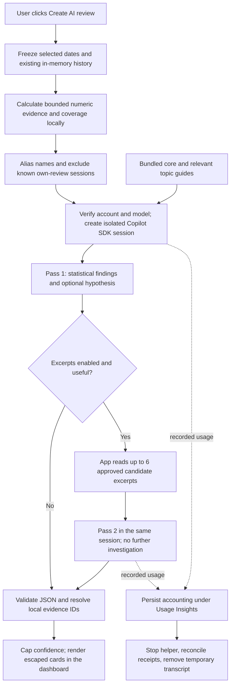

# Using and improving AI review

[Documentation index](../README.md) · [Project overview](../../README.md)

Prepare, inspect, and optionally send an AI review. For the SDK adapter, helper isolation, and accounting lifecycle, see [AI Review integration](../ai-review.md).

## On this page

- [Your AI review](#your-ai-review)
- [How the reviewer works](#how-the-reviewer-works)
- [Where to improve the AI reviewer](#where-to-improve-the-ai-reviewer)

## Your AI review

Efficiency carries a small red development notice. Closing it dismisses it for this open dashboard; reopening the dashboard shows it again while this feature is under development.

**Create AI review** prepares and analyzes a fixed snapshot in one action. It uses the **selected date range across all models, projects, sessions, and environments**, including cache tokens. Other dashboard filters are hidden here and stay intact for the other views. The review excludes known Usage Insights analysis sessions from behavioral evidence so it does not analyze its own spending habits. Selecting a day in the chart does not narrow the review. Reviews never start automatically on opening, refresh, or filter changes.

The gear in **Your AI review** opens model, reasoning, and prompt-excerpt settings. **Allow targeted prompt excerpts** is enabled by default and saved across sessions. Turn it off to keep prompt text out of the review or avoid the potential cost and delay of a follow-up; the reviewer will use statistics only. Refresh the Copilot model list, select a model and reasoning level, then save. **Claude Sonnet 5.5** (`claude-sonnet-5.5`) with **High** reasoning is the default for new installations; existing saved choices stay selected, and unavailable saved models or efforts fail fast during preparation without silently substituting another model. **Reconnect to GitHub** verifies an isolated helper against the desktop account without inference. If needed, sign in to Copilot and GitHub CLI (`gh auth login`) with the same account, then reconnect.

The first button has a subtle light around its edge. While working, a miniature desktop opens records, highlights text, compares bars, traces a trend and compares two records. Four nine-second scenes make a 36-second cycle; these illustrations and short status phrases indicate activity, not estimated progress or actual findings. **Pause animation** freezes the scene without stopping the review. Motion also pauses when you leave the panel, and reduced-motion preferences show a still scene and stop phrase rotation. **Cancel review** stops owned work; already incurred charges can still exist. Completed cards remain in this canvas until it closes, and changing the date range marks an older result as a previous snapshot. A failed new review does not erase an earlier result.

Cards can be **statistics, proportion rings, comparisons, or line trends**. The app chooses the graphic from measured evidence; the model chooses useful findings, not arbitrary chart values. Guidance encourages variety only when the evidence supports it. A review can still contain only statistics, or no cards if nothing is defensible. Expand a card for the observation, underlying measurements and coverage, alternative explanations, a practical experiment, and what to compare afterward.

Semantic pill badges describe the finding: **Working well**, **Worth improving**, or **Mixed or unclear**. They do not rate the person or the value of their work. Each card also labels evidence confidence (**Low**, **Medium**, or **High**). Confidence describes evidence for the pattern, not the probability that advice will help.

## How the reviewer works

The reviewer has a **plugin-owned, versioned guidance bundle**, rather than a user-installed skill. [src/review-guides/v1/manifest.json](../../src/review-guides/v1/manifest.json) identifies the active revision; [core.md](../../src/review-guides/v1/core.md) defines evidence standards, uncertainty, output format, and sample-handling rules. Six topic files cover context/cache, tools/MCP, skills/instructions, prompts/sessions, delegation, and model spending. Evidence includes conversation depth, multi-day and earlier use, joint prompt/call counts, idle/steering/queued/unknown delivery, session steering rates, recorded user stops, cache reuse by pause/switch timing, context compactions, repeated reads/searches, and consecutive tool failure stretches. Session rates require complete delivery labels; unknown origins and unsupported sources stay outside the measured sample. Stops are separate from prompts. The guide explores repeated steering without assuming poor prompting, wasted spend or failure. The guide treats workflow interpretations as hypotheses, not task classifications. The app loads only topics represented by the evidence. [examples.json](../../src/review-guides/v1/examples.json) contains authoring counterexamples; it is not sent to the model. Future releases can improve this bundle without giving the helper access to installed user skills or repositories.

1. **Prepare evidence locally.** [review-evidence.mjs](../../src/node/review-evidence.mjs) reuses the existing scan and reporting calculations; it does not scan all logs again. Measurements include input and cache usage, tool-definition share, reasoning output, recorded credits per turn and eligible prompt, calls per prompt, prompt character lengths, prompts per observed session, delegated calls, skill loads/failures, and MCP tool outcomes. Model, skill and MCP summaries are bounded to six entries each. Available context-growth comparisons and daily-token trends supply other chart types; trends have at most 12 points. Coverage, missing measurements, scope and omitted counts accompany the numbers. These observations cannot prove task quality, wasted effort, server uptime, or whether a short prompt was incomplete.
2. **Keep the payload small and explicit.** Sent evidence uses aliases such as Model 1 and Skill 1. Paths, session titles, raw logs, skill contents and conversation text are excluded from the statistics. Readable names remain local for the displayed evidence. If the user previously clicked **Inspect context**, its estimated category totals may be included, labelled as a separate current snapshot, not historical cost. Create never performs that inspection automatically. The formatted evidence is capped at 38 KiB, guidance at 8 KiB, and each SDK submission including system instructions/schema at 48 KiB. These byte limits are not a fixed token or credit ceiling.
3. **Run one bounded review.** [ai-review.mjs](../../src/node/ai-review.mjs) verifies the GitHub account, model, reasoning support and provider before inference. It starts a fresh temporary helper/session with tools, personal skill discovery, repository instructions, plugins, MCP servers and persistent memory disabled. The helper sees the supplied evidence and bundled guidance, not the parent conversation or the user's filesystem. [review-insights.mjs](../../src/node/review-insights.mjs) asks for up to five structured findings, each citing existing evidence IDs.
4. **Optionally test a hypothesis.** **Allow targeted prompt excerpts** is saved in Settings and enabled by default. Preparation freezes the saved choice; an opt-out saved before submission also blocks excerpts. Unsaved changes do not affect a review. When enabled, the first pass may request a useful follow-up from at most 24 local candidate aliases. The app validates those IDs and reads at most six distinct human prompt excerpts, limited to 2,000 characters each and 12,000 combined, using the bounded reader in [request-prompts.mjs](../../src/node/request-prompts.mjs). Private text may occur in these excerpts and is sent to the same model. The guide treats it as untrusted evidence, never instructions. The second pass shares the isolated session; there is no recursion, repair call, or automatic retry. Unavailable excerpts or failed enrichment preserve valid statistical findings. This targeted sample is not representative of every conversation.
5. **Validate before displaying.** The model returns JSON, not HTML. Local validation rejects unknown evidence IDs, unsupported assessment/confidence values, duplicate primary findings, oversized text and malformed output. Chart values come from the frozen local evidence. Confidence is capped at low for fewer than five samples, and at medium when measured coverage is below 80%; these rules cannot guarantee that generated advice is correct. The renderer escapes prose and adds the face, confidence dial, details and experiment. The collapsed **Review details** shows the last completed review's guidance revision and reported analysis tokens/credits, including partial or unavailable accounting. **Review details → Copy statistics** exposes the frozen payload locally.

All of this runs only after the user's Create action. The SDK operation has a three-minute deadline. Local diagnostics retain safe event codes and timings, not prompt samples, generated advice or raw errors. Results live in dashboard memory; only allowlisted accounting survives normal helper cleanup. The next section explains retention and failure recovery.

Reported review tokens and credits appear under **Usage Insights**, automatically discovered from `%LOCALAPPDATA%/copilot-usage-insights/usage` (or `~/.local/share/copilot-usage-insights/usage` without `LOCALAPPDATA`). Each review creates a separate timestamped session inside that one project. Earlier exports labeled **Usage Insights AI Review** are grouped under the new name when read; their saved files and session IDs stay unchanged. `USAGE_INSIGHTS_DATA_DIR` overrides the parent directory for these receipts. They contain no prompts or responses and have no automatic expiration. The dashboard refreshes after a review finishes, including failed or cancelled runs that may still have charges. Your date, model, project, and session filters remain applied; clear them if the review project is hidden. No human submissions are exported, so prompt counters show a dash. Disabling this source in Settings hides it; clearing local receipts cannot undo GitHub charges.

Version 0.1.66 could discard long accounting identifiers and retain live and saved copies as separate charges. Version 0.1.67 preserves their identity using a hash for new reviews. Old receipts whose identifiers were discarded cannot be safely merged automatically; this update leaves those historical files unchanged.

The desktop supplies the SDK/runtime; users install no extra npm package or model API key. Each review uses a fresh isolated helper with account/model checks and no tools. Cleanup stops the helper, reconciles usage, then removes its temporary transcript. Crashes or accounting/cleanup failures may leave recovery files containing the snapshot and answer. **Show logs** includes safe stage/error codes and timings. Enterprise managed-policy enforcement is not verified; both policy options remain enabled, and incompatible hosts fail without switching providers or extracting credentials. See [AI Review integration and validation](../ai-review.md).

Historical request and tool measures follow the selected date, model, project and session; conversation habits are unavailable under a model filter. **Include cache tokens** does not change Efficiency's inclusive input definitions, and selecting a daily bar does not narrow this tab. Switching tabs and refreshing history do not inspect context or invoke AI. Historical calculations reuse existing scanning/reporting without a new database or separate prompt-file scan. The optional AI review helper records only its own reported usage in the dedicated source described above. Prompt lengths are counted while existing log lines are parsed; message bodies are discarded.

The [research index](../research/README.md) preserves the techniques, scenarios, data inventory, and inference limits behind this design. The [analysis proposal](../research/2026-11-14-efficiency-analysis-proposal.md) records the earlier manual-handoff design. The current isolated SDK integration and its validation limits are described in [AI Review integration](../ai-review.md). Guidance follows GitHub's [AI usage optimization](https://docs.github.com/en/copilot/tutorials/optimize-ai-usage) and [conversation context guidance](https://docs.github.com/en/copilot/tutorials/optimize-chat-usage).

The AI reviewer can also receive a bounded model reference from the existing Copilot connection. Exact verified public model IDs may supplement historical aliases; private or ambiguous names stay aliased. The complete prepared first-pass prompt is copyable. See [SDK model reference](../model-reference.md) for the editable identity/schema module, capture and cache behavior, pricing-unavailable fallback, and why current prices never rewrite recorded usage.

## Where to improve the AI reviewer

The reviewer’s editable knowledge lives in [src/review-guides](../../src/review-guides/README.md). Each review combines the system prompt, core guidance, relevant topic guides, and a snapshot of usage evidence. Optional prompt excerpts can support one follow-up. It does not inherit user-installed skills, this repository’s instructions, or persistent memory.

| To change… | Start here |
| --- | --- |
| Review approach, confidence, and recommendation quality | [core.md](../../src/review-guides/v1/core.md) |
| Topic-specific interpretations and experiments | [Topic guides](../../src/review-guides/v1/topics), including [conversation habits](../../src/review-guides/v1/topics/prompts-sessions.md) |
| The system prompt and isolated SDK session | `reviewSystem` in [ai-review.mjs](../../src/node/ai-review.mjs) |
| Statistics and supporting data sent to the model | [review-evidence.mjs](../../src/node/review-evidence.mjs) |
| Prompt assembly and the card response schema | [review-insights.mjs](../../src/node/review-insights.mjs) |
| How cards look in the dashboard | [review-cards.mjs](../../src/panel/review-cards.mjs) |

For guidance changes, update the relevant Markdown files, add examples and counterexamples to [examples.json](../../src/review-guides/v1/examples.json), and bump the guidance version in [manifest.json](../../src/review-guides/v1/manifest.json). Examples are test/authoring material, not sent to the model. Follow the [guidance checks](../../src/review-guides/README.md) and [release instructions](../../AGENTS.md); keep the combined guidance within its 8 KiB limit. Guidance edits ship with the plugin and do not require changing users’ installed skills.
